# NraKit

**Small quality-of-life tweaks for WoW Forever. Every feature is off by default, so turn on only what you want.**

## Getting Started

Type **/nrakit** (or **/nra**) to open NraKit's own window.
- Features are grouped in a sidebar, with **search**, an on/off switch per feature and its options right underneath.
- The same settings are also under **Options → AddOns → NraKit**.
- NraKit's windows (Settings, Inventory, Goals, Notes, Items, Wishlist, Reminders & To-Do) work as **tabs of one window**. Tabs of features that are off are dimmed: they say what the feature does and **turn it on with one click**.
- NraKit is also in the **addon button by the minimap** (no extra minimap button): left-click for settings, right-click for a menu of its windows.
- **/nra help** lists the chat commands.
- **/nra preview** shows any of NraKit's on-screen messages (goal complete, quest reminders, alerts...) with made-up content, to see how they look.

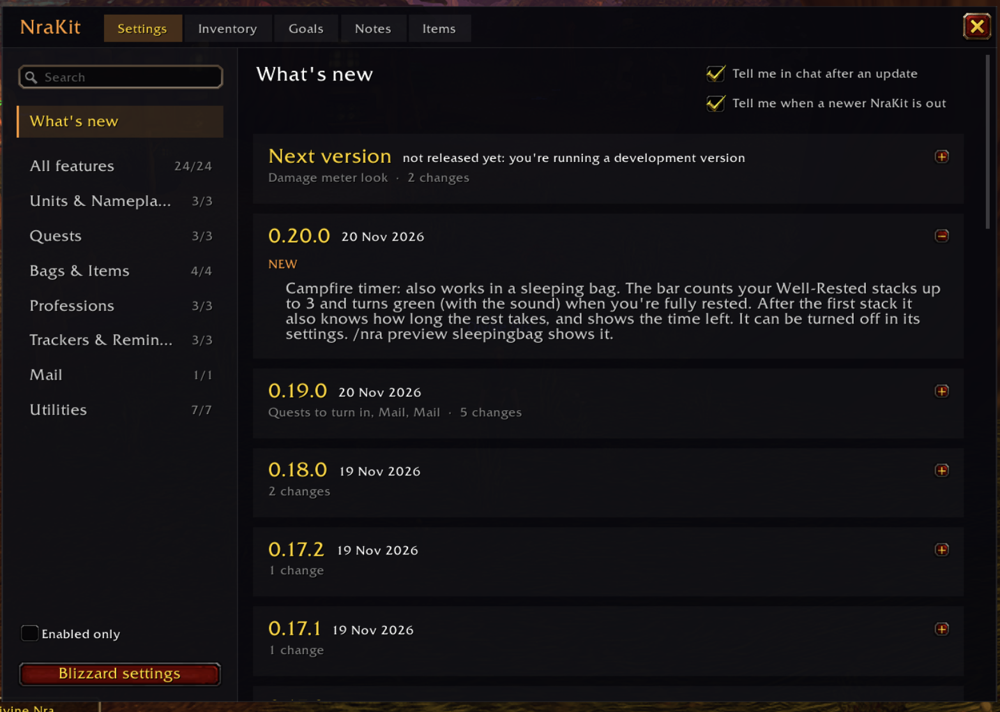

**What's New** (**/nra new**, at the top of the NraKit window) shows what changed in every version, and new features can be turned on right there.
- After an update, NraKit tells you in one chat line (you can turn that off).
- It also tells you when a **newer version is out**, if someone in your guild or group already has it.
- **/nra who** lists who in your guild and group runs NraKit, and how many NraKit users you've come across.
- Both of these can be switched off.

Alert **sounds are yours to choose** (Campfire Timer, Unit Scanner, Farm Goals, Player Notes, Reminders & To-Dos): a short list of good ones (hover to hear them), or **More sounds...** to search every game sound and any sounds other addons share through LibSharedMedia.

## Interface

### Class-Colored Health Bars
Your player, target, target-of-target, focus and party frames show **class-colored health bars** for players. NPCs keep their normal colors.

### Engaged-Only Nameplates
See plates only for the enemies that are actually fighting you.
- Full nameplates **only for enemies attacking you** (optionally also your party/raid).
- Every other enemy is hidden, so no more wall of health bars from mobs you aren't fighting.
- Optionally keep idle enemies' **names**, styled like the game's own overhead names, with adjustable size, height, outline and shadow.
- Optionally turns enemy nameplates **on when you enter combat and off when you leave it**, so you get clean overhead names while questing. (Forever's own "Always Show Nameplates" setting doesn't limit plates to combat at the moment.)
- If you turn enemy nameplates on yourself (V), they stay on.
- Your target, focus and enemy players always get full nameplates.

### Cooldown Manager Fade
The game's **Cooldown Manager** bars show in combat and **fade out a while after it**, animated, instead of just vanishing.
- Set the bars to **Always** in Edit Mode: one set to "In combat" is hidden by the game before it can fade. Visible is the bar's own Edit Mode opacity.
- Pick **which bars**: Essential Cooldowns and Utility Cooldowns (on by default), Tracked Buffs and Tracked Bars.
- **Stay after combat** (10 seconds), **Fade over** (2 seconds) and **Faded opacity** (0%, or a faint trace).
- They also come back with a **hostile target** (lining up a pull), fading right away when you drop it, and while the **mouse is over** a bar. Each is an option.
- Every change is animated: fading in is quick, but never a jump.

### Damage Meter Look
A **clean, flat look** for the game's own damage meter.
- The header becomes a **thin dark strip** with a small gold title and small grey buttons, shown **only while your mouse is over the meter** (optional).
- **Flat bars** in a softer class colour, with **outlined text**.
- Size, style, icons and class colours are still set in **Edit Mode**.
- Turning it off asks for a **reload** to bring back the game's look.
- `/nra dps` **shows or hides the damage meter** (the game's own setting), whether or not the look is on. `/nra dps show` and `/nra dps hide` do one or the other. With the meter's visibility set to **Always** in Edit Mode, `/nra dps` alone decides.

### Hide Micro Menu Notifications
- Hides the blue notification dot on the **Shop** button that never goes away.
- Makes the **Legacy** button's dot show only when you have **unspent Legacy points**, not for every new challenge.

## Classes

### Warrior
**Tactical Mastery mark:** the rage bar of the **Personal Resource Display** shows a small arrow at how much rage you **keep when you change stance**: 10 from Tactical Mastery, plus 5 per rank of Improved Tactical Mastery. It follows what you've learned and your talents by itself. The arrow sits at the top, bottom or both, at the size you like, and you can shade the bar up to it.

**Proc alerts:** the game shows no proc glow for **Overpower, Revenge, Victory Rush and Execute**, so NraKit makes their action buttons glow (the game's own proc glow) while you can use them. Bright means press it now; dim means it's up but you're short of rage or it's on cooldown. A thin gold bar along the button drains as the proc runs out, turning orange with the glow pulsing at the end; Victory Rush also counts down its seconds. Its time comes from its buff; NraKit learns Overpower's and Revenge's the first time one runs out. Optionally a sound, and the icon next to the Personal Resource Display's rage bar.

## Quests

### Best Quest Reward
When a quest lets you choose a reward, a **gold coin** marks the one that sells to a vendor for the most gold (sell price × stack size).

### Quest Level
Shows the **quest's level in front of its title** in the quest dialog and quest details, like **[24] The Defias Brotherhood**, colored by difficulty just like the quest log.

### Quests to Turn In
Running around with finished quests you forgot about? **/nra done** (or a key under Key Bindings → NraKit) shows a **small list of your finished quests by the zone you turn them in**: the zone you're in first, then the **nearest**.
- **Click** a quest to open the map on it (its turn-in shows there, and the list stays open).
- **Right-click** it, or click its **round quest icon** (as in the objective tracker), to make it your **waypoint**.
- **Shift+click** to link it.
- Entering a zone where you have quests to turn in **pops a small message** with the zone's name and your quests to turn in there, one per line, together with your reminders and to-dos for that zone (click a quest to open the list; a chat line is optional). It can also open the list itself (off by default).

## Bags & Items

### Bag Tithe
Find out what to throw away when your bags are full.
- A button next to the bag sort button **highlights your least valuable slots** (sell price × stack size), ranked from red to yellow, with rank numbers and sell values.
- Everything else is dimmed; your bags work as normal underneath.
- **Alt+click** an item to leave it out of the ranking. The ignore list can be edited in the options.

### Potential Upgrades
**Arrows on bag items and quest rewards**, plus a tooltip line, for items that beat what you're wearing.
- **Green**: clear upgrade. Usable now and at least as good on every stat that matters for your class (plus armor or weapon DPS).
- **Yellow**: likely upgrade, using a simple per-class stat priority.
- **Grey**: an upgrade once you reach the required level.
- Green **"Equip:" bonuses** count too: attack power, spell power and healing, mana per 5, and chance to hit or crit, each at a rough worth for your class. Other effects (on use, procs, set bonuses) can't be judged, so items with them are never called clear.
- It's a **clue while leveling**, to help you decide, not an exact calculation.

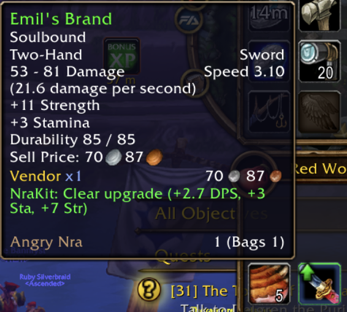

### Inventory Tracker
Where did I put that? **Item tooltips show how many each of your characters has**, and where: bags, bank, mail or equipped, plus a total.
- Visit the bank and mailbox once on each character so they're known; after that they stay up to date.
- Items you **mail to your own characters** show up on them right away.
- **Hover your gold** at the bottom of your bags to see every character's gold, and the total.
- **Inventory browser** (**/nra inv** or a key binding): every character with level and gold, and their **bags, bank, mail and equipped** items as a bag-style grid or a list.
- The browser has **search**, category filters (gear, consumables, trade goods, recipes, quest), how fresh each location is, and the **vendor value** of what's shown.
- **All characters** view lists who has what. Right-click a character to forget it.

### Open Clams
A small button at the bottom of your bags, next to your money, **opens the next clam** **one click at a time**, and shows how many are left.
- Works for any "Right Click to Open" container, except locked boxes.
- Can be **bound to a key** (Key Bindings → NraKit).
- Openable items get a **green border** in your bags.

### Wishlist
A **list of gear you want**, by slot, **ticked off when you get it**.
- Add items with **/nra wishlist &lt;item&gt; [note]** (shift-click the item in; anything after it becomes its note; shift-click several to add them all at once), by **right-clicking an item link in chat** or an item in Item Lookup, or by **dropping an item** on the window. **/nra wish** is short for it.
- The **Wishlist** tab lists them in a section per slot, with the **level to wear** each one (grey while it's above yours). Filter by **Ready** (you can wear it), **Not yet** or **Got**, or search names and notes.
- Click an item to write a **note** on where it comes from (NraKit has no database of sources). Right-click for got / not got, a Wowhead link, or remove.
- Items you have (bags, bank or worn) are **ticked off**, with a message when one lands in your bags. An option takes them off the list instead.
- A **star** marks wishlist items in your bags, at vendors, in quest rewards, the loot window, loot rolls and Item Lookup: gold while you want it, grey once you have it.
- **Item tooltips** say when an item is on your wishlist, with your note.

## Professions

### Known Recipes
No more mousing over every recipe at a vendor. Recipes you **already know get a green check** and a greyed-out icon at vendors, and a check in your bags.
- Optionally marks recipes for your professions that you **can learn now (green +)** or **once your skill is high enough (yellow +)**.
- Works for anything the game calls "Already known".
- Optionally makes **Bag Tithe** rank known recipes as junk.

### Sous Chef
Have the meat but not the spices? In the cooking window, recipes where you have the **main ingredient** but are missing **vendor-bought extras** (spices, water, flour...) show an icon of **what to buy and how much**.
- Tooltips on main ingredients list what they cook into and what's missing.
- Optionally only for recipes that still give skill, and optionally for all professions.

### Double-Click Fishing
With a **fishing pole in your main hand**, **double right-click** the world to cast Fishing.
- Right-clicking NPCs and players, and holding right-click to turn the camera, work as normal.
- The double-click time is adjustable.

## Auction House

### Sell List
**What in your bags is worth selling**, the most valuable first, so you don't have to hover every item.
- **Auction house and vendor prices side by side** (auction prices from Auctionator); the better one is bright, and a **stale** auction price is marked.
- It **opens by itself beside the auction house** (switch that off at its top), and a **button on the auction house** opens it too. There, **Alt+click** an item to put it in **Auctionator's Selling tab**, or click to pick it up for the sell slot. Also in the Inventory tab, and `/nra sell`.
- After a fresh scan it says **"Prices have changed"** by the **refresh** button.
- Split into **To Sell: Auction House** and **To Sell: Vendor** (soulbound items too); right-click one for **Keep, don't list** on what you use.
- Optionally also **opens at merchants**, docked beside them with the vendor group first.
- **Bank** and **Mail** switches list what's in your bank and mailbox too, mixed in by value but **marked** (a badge and a tint of their own), counted apart in the footer.
- **At the bank or mailbox, click one to take it** into your bags; with more than one stack it asks how many (**Take All** takes what fits).
- Leaves out junk below a **minimum**, sorts by **any column**.

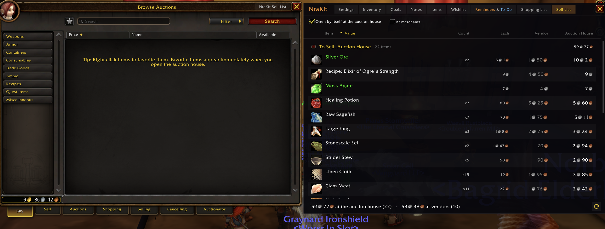

### Auctionator Prices
Needs **Auctionator**. What things cost at the auction house, from Auctionator's last scan.
- **Waylaid Crates:** a crate's tooltip shows **what each bundle it takes costs**, with the **cheapest in green**. An Auctionator shopping list, **"Waylaid Crates"**, holds every bundle of the crates in your bags, in the amounts they need. It's rewritten when your crates change, but not while the auction house is open. `/nra crates check` compares NraKit's crate list with the game's own tooltips (after a patch, say).
- **Recipes:** a recipe's tooltip (click a recipe link in chat) shows **what one craft costs**: each reagent and the total.
- **How many you have** of each reagent, on recipes and crates: on all your characters (with Inventory Tracker; else your bags and bank), **green** when your bags hold enough, **yellow** when you have enough elsewhere (bank, other characters), grey if not. When they aren't all in your bags, a line under it says **where**: "You 3 (Bags 2, Bank 1), Bankalt 12". A recipe also says what's left **to buy**.
- **Shopping lists:** right-click a recipe link in chat or a recipe in your profession window (or use the **Shopping List** button by its reagents) for **Create shopping list for this recipe** (an Auctionator list named after the recipe, with one craft's reagents) or **Add to NraKit Shopping List** (adds one craft's reagents to your big list).
- **The NraKit Shopping List** (`/nra shop`, a tab in the NraKit window): everything you're crafting, with what it's for, the **amount** (type it, or - and +), the price of one and of them all, and **how many you have** on all your characters (hover for who; needs Inventory Tracker, else your bags and bank). Remove items, or **Clear list** (it asks first). Auctionator gets a copy, **"NraKit Shopping List"**, kept up to date while you're away from the auction house; at it, **Search at AH** searches for everything.
- **Vendor items** (thread, dye, vials...) show the **vendor's price**, tagged "vendor": NraKit remembers what merchants you visit sell (Auctionator's vendor prices fill the gaps). They're left out of Auctionator lists (an option).
- Optionally shows the price per item too.
- **Inventory value:** the Inventory tab shows what each character's items are worth at the auction house.

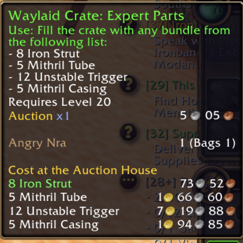
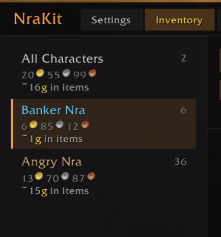

## Mail

Helpers for the mailbox, each one an option (all on once you turn **Mail** on).

**Open selected mail**: a **checkbox on each mail** in your inbox. Tick the ones you want and the **Open All** button becomes **Open Selected**, opening only those.

**Open All menu**: an **arrow next to Open All** with more ways to open, each showing how many mails and how much gold first:
- **Collect auction gold** (sales and outbid refunds)
- **Collect auction purchases**
- **Collect expired auctions** (unsold and cancelled)
- **Take money only** (the gold from every mail, items left in)

Gold works even with full bags; C.O.D. and GM mail are never touched.

**Fill in mail subject**: the **subject** of a mail you're sending is written from **what you attach**: "Linen Cloth (40)", "Linen Cloth (40), Wool Cloth (20)", "25g" or "Linen Cloth (20) + 5g". A subject you typed yourself is never replaced.

**Remember mail recipient**: the **To** box **keeps the name after you send** a mail, so sending several mails to the same player (like your **bank alt**) needs no retyping. It can also fill in the **last player you mailed** when you open Send Mail.

**Alt+click to attach all**: with Send Mail open, **Alt+click an item in your bags** to attach **every stack** of it you have (all your Silk Cloth, all 4 Small Red Pouches), as many as fit in the mail.

## Trackers & Reminders

### Unspent Talent Points
A **reminder in the middle of the screen** while you have talent points to spend. Size and position are adjustable. It hides while the talents window is open, and can hide in combat.

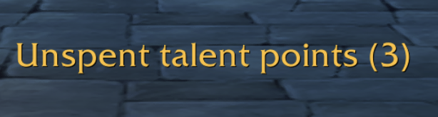

### Unlearned Abilities
After a respec, abilities you don't know anymore stay on your bars, only greyed out. This makes them stand out.
- A **red cross** on their button, and a tooltip line saying it's not learned.
- When your spells change, a message lists the abilities on your bars you lost (once you close the talents window). **Click it to take them off**: it asks first, and waits for combat to end if you're fighting.
- It also lists **new abilities** that aren't on your bars yet.
- **/nra unlearned** lists them, **/nra unlearned remove** takes them off.

### Reminders & To-Dos
Notes to yourself that come back when they're due. **/nra remind Go to Darkshore and hand in quests** pops up the next time you log in; **/nra todo respec** just goes on your **to-do list** on screen.
- **Later instead:** a time (**/nra remind 30m check the AH**; s, m, h, d), a zone (**in Darkshore: ...**, straight away if you're there), a level (**at 30: ...**), or **another character's next login** (**@Bankalt: mail the bags**, also with a trigger). The same works for to-dos.
- Shift-clicked items and quests work in the text.
- **Reminders** show on a **card that stays until you close it**, led by **why** each came due (you entered Darkshore, time's up, from Bankalt); at login it also lists the reminders still open from before. They wait for combat to end, and play a sound you can pick.
- **To-dos** skip the card: they go straight on the list. **Zone to-dos** are on the list while you're there: leave and a short countdown takes them off, and they come back when you return (with a small message for arriving).
- **The list on screen** holds both until you tick them, reminders and to-dos in their own parts, **in your order** (drag a row, or use its arrows). Tags say where, when or who from, and zone tags turn green while you're there. Ticked ones fade out. Its header: click to fold, shift-click to hide, right-click for the tab, shift-right-click for the settings; **/nra todo show** or a key brings it back if you hid it.
- Set the list's size, background opacity (header and items together or apart, and on hover), overall opacity, width and height (it scrolls past that), which way it grows (down or up), hide its header, and lock it or hide it in combat.
- The **Reminders & To-Do tab** (**/nra remind**) lists them all, with the ones you left your other characters. Edit them there (the gear on a row changes everything: when, where, for whom), or right-click to be reminded again later. Click **Add** with the box empty for a **form** to pick when (a time, a zone from a list, a level), for which character, and whether it pops up.

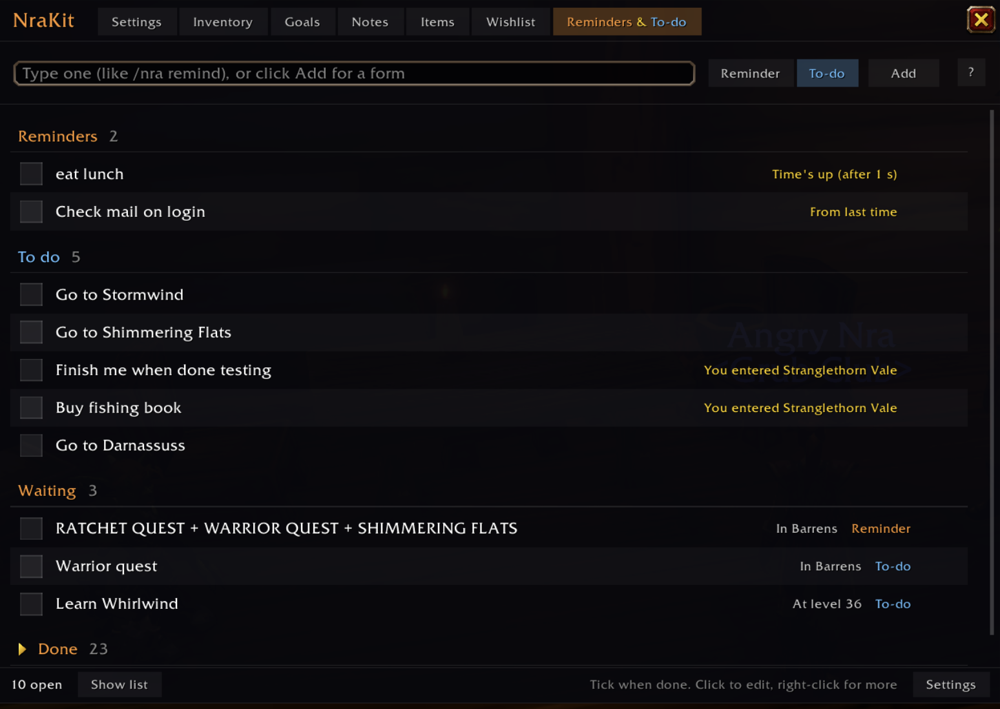

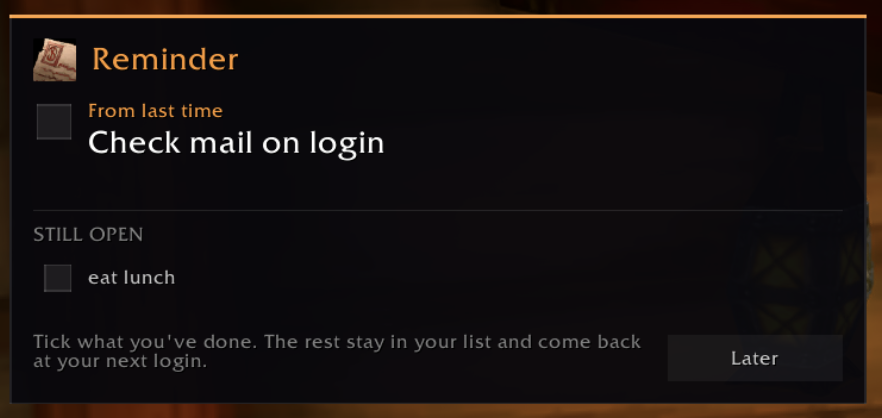

### Campfire Timer
A **progress bar in the middle of the screen** while you rest at a Welcoming Campfire, with the time left. It turns green (with a sound) when Camp Benefits is ready.
- **Sleeping bags too:** it counts your Well-Rested stacks up to 3, with the time left once it has seen how long a stack takes.
- Width and position are adjustable.
- **/nra campfire** shows a 10-second preview, **/nra preview sleepingbag** the sleeping bag.

### Farm Goals
Just want to farm something? Set a goal and a small **movable tracker** shows the progress, how much you've gained, your **rate per hour** and **time left**.

**Goals like:** **loot 4000 Silk Cloth**, **reach level 40**, **gain 50,000 XP**, **earn 100 gold**, **reach Revered with a faction**, **get Swords to 300** (or to whatever your cap is) or **collect a currency**.

**Progress and finishing**
- Progress bars are **marked at 25/50/75%**, optionally with a chime and a small message when you pass them.
- A **fanfare** and a big message in the middle of the screen when a goal is done (shown again after the fight if you finished it in combat). The finished goal **glows in the tracker** until you hover it.
- Finished? **Click** it to clear it to the history (you can restore it), or right-click to **go again** (another run of the same amount) or set a new target.
- Item goals count **what you loot**, so banking, mailing or selling never throws them off.
- Optionally **start from what you already have**: bags, bank, mail and other characters (with a live preview).

**The tracker**
- Three views: **Full**, **Compact** (one line per goal) and **Icons** (a tile per goal with a bar and the amount, as small as one icon, growing sideways up to 3 per row; the buttons appear on hover).
- Pick a view from the arrow menu in the tracker's header (which can also lock it in place).
- Right-click a goal to pause, **edit**, **shelve** (hide it from the tracker, paused, until you bring it back), reset or remove it. Edit fixes the target, item, starting count or sounds without starting over.
- Each goal can have **its own sounds** for milestones and for finishing.
- **Icons** follow what a goal tracks (an axe for Axes, a pick for Mining, coins for gold), or **pick your own** like a macro icon: click the icon in the goal form and choose one, or drop an item or spell on it.

**Commands**
- **/nra goal** opens the goals window (new goal, active and shelved goals, history).
- Or add goals from chat: **/nra goal 4000** plus a shift-clicked item, **/nra goal level 40**, **/nra goal gold 1g 50s**, **/nra goal rep revered timbermaw**, **/nra goal skill swords**, **/nra goal currency 2000 honor**... (**/nra goal help** lists them all).

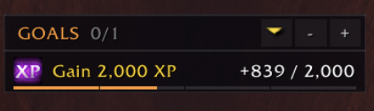
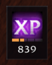

### Unit Scanner
Get alerted when a **mob or player from your own list** shows up.
- **Sound, on-screen text, chat line** and a flashing taskbar icon, each optional.
- Found units get a **raid marker** (Moon by default), and a **button to target them** with one click or a keybind.
- Target a unit and type **/nra scan** to add it (again to remove it), or use **/nra scan &lt;name or NPC ID&gt;**, **/nra scan list**, **/nra scan remove &lt;# or name&gt;** and **/nra scan clear**.
- Units are found through nameplates, mouseover, your and your group's targets, **minimap markers** (rares) and **NPC yells and emotes**. The nameplate range can optionally be raised while scanning.
- Addons can only see units the game already shows you, so keep enemy nameplates on (with Engaged-Only Nameplates, the scanner keeps them on for you).
- With **Player Notes**, it also alerts you when a player you've labelled **Kill on sight** shows up (optional, on by default).

## Social

### Player Notes
Remember who stole your mining node, who ninja'd the loot and who was a great healer.
- Give a player a **label** (Kill on sight, Avoid, Neutral or Liked), **tags** of your own and a **dated log of notes** (each note saves the date, zone and your character).
- Their label, tags and latest note show in their **tooltip**.
- **Right-click a player** (portrait, party frame, their name in chat, guild and friends lists) → **Player note** to label them in one click, or to open their notes.
- **Warnings** when a player labelled Avoid or Kill on sight joins your group, invites you, whispers you or opens a trade (chat, on screen and a sound, each optional).
- **Rate** the players you like, 1 to 5 stars in halves: the stars next to Liked on their page, or right-click → Player note → **Like and rate**, which then opens their notes to add a note or tags (an option). The stars show in their tooltip and your notes.
- What the label does: **Kill on sight** (warnings and Unit Scanner alerts), **Avoid** (warnings), Neutral or Liked (tooltip only).

**Tags**
- Group players your way: **Ninjalooter, Good tank, Guildie**. A player can have any number.
- The notebook's list has a **section per tag**, then the players without tags. **Filter chips** under the search (KoS, Avoid, Neutral, Liked) narrow it to those labels. Click a section to fold it, shift-click to fold all the others, or use **Fold all**.
- On a player's page, **+ Tag** lists your tags to tick, or makes a new one. From chat, use **#**.
- The **Tags** page adds tags, renames them (renaming into an existing tag merges them) and deletes them.

**Your notebook**
- **/nra note** opens your notebook, or your target's notes.
- **+ Add player** adds anyone by first name and surname, or your target. Search by name, label, tag or note text.

**From chat**
- **/nra note Bob Stone kos #ninjalooter stole my node**
- With a player targeted, just **/nra note ninja'd the loot** (or **/nra note avoid ninja'd the loot** to label them too).
- **/nra note !remove** takes your target out of your notes (**!undo** brings them back).

**Share notes in chat**
- **Shift-click a player** in your notebook (or **Link in chat** on their page) to put **[NraKit note: Name]** in your chat box.
- Others with NraKit see it as a link. Clicking it shows the player's label, tags and notes, with **Add** and **Cancel**.
- Added notes keep who wrote them. Notes you already have are skipped, their tags can be left out, and your own label (and rating) stays unless you pick theirs.
- Only players you've linked can be fetched, and only while you're online.

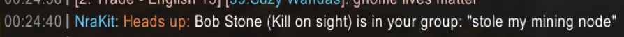

### Inspect Anything
**One key** (Key Bindings → NraKit) inspects **your target** (or whatever is **under your mouse** when you have none), in a window like the inspect window that **stays open until you close it**, even when they run off or you change target.

**Players**
- Their **gear** around the model (tooltips, Shift+click to link), **spec and item level**.
- Inspected in combat, their gear **fills in after combat**.
- **Blizzard's inspect** opens the game's own window (talents, PvP, guild) while they're near, and **Dressing room** tries their outfit on.

**NPCs**
- Their **3D model** to look at (**drag to turn**, **right-drag to move**, **mouse wheel to zoom**), with level, type, health and attack speed.
- An **Abilities on Wowhead** button: the game doesn't tell addons what NPCs can do, so it gives you their Wowhead link.

Also in the **right-click menu** of NPCs and enemy players: **View 3D model** (optional).

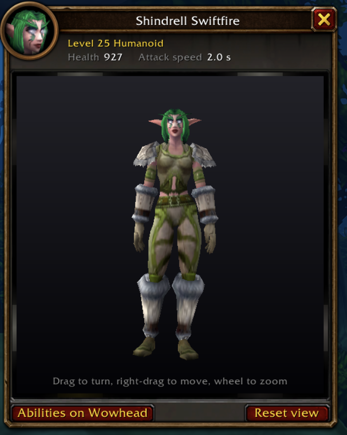

### Leave Group with /leave
Type **/leave** (with nothing after it) or **/leavegroup** to leave your party, raid or instance group. **/leave &lt;channel&gt;** still leaves a chat channel.

## Tools

### Item Lookup
**Search every item in the game by name.** **/nra item nightbl** opens an **Items** tab listing every item whose name contains it, best matches first, with icon, type, required level and how many your characters have (with Inventory Tracker).
- Hover for the tooltip, **Shift+click** to link it in chat, **Ctrl+click** to preview it, **right-click** to add it to your **Wishlist** (while that's on).
- The game can't search items by name, so NraKit learns the names in the background, a few dozen a second (paused in combat). It takes a few minutes, once per game version; searching works right away and finds more as it fills.
- A **progress bar** in the tab shows how far it is, with **Pause / Resume**, and **Check again** once it's done.
- Items nobody has discovered yet can't be looked up until they have been; NraKit checks for them again every day (or right away with Check again).

### Copy Wowhead Link
Hover an **item, spell, NPC, quest, achievement or currency** and press **Ctrl+C**. A box opens in the middle of the screen with its **wowhead.com/forever** link selected; copy it with **Ctrl+C** (**Cmd+C** on a Mac) and the box closes.
- Addons can't reach the clipboard directly, hence the box.
- Works on bag items, chat links, NPCs in the world, the quest log, achievements and the objective tracker.
- Ctrl+C is bound on first use if it's free; change it under Key Bindings → NraKit.

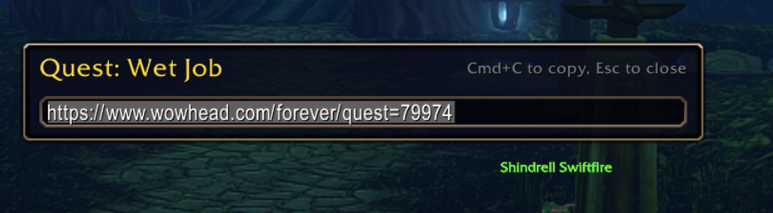

### Shortcuts
Short commands for NraKit's everyday ones, each the same as its `/nra` command: **`/remind`, `/todo`, `/item`, `/dps`, `/shop`, `/bank`, `/goal`, `/note`, `/wish`, `/scan` and `/done`**.
- NraKit **only takes ones nobody else uses**: a command another addon, the game or an emote already has is left alone, and an addon that takes one later gets it. `/nra` always works.
- `/nra shortcuts` lists them, and which are in use elsewhere (and by what).
- Each can be turned off, and one whose feature is off isn't taken.

### NraKit Button
NraKit's icon on screen, **wherever you drag it**.
- A **badge counts what you may have missed**: reminders you haven't ticked off and, if you want, what's new.
- **Pick what clicking and shift-clicking it do** (what's waiting, a window, your reminders...); right-click is NraKit's menu.
- Lock it, size it, or hide it in combat.

## Feedback and Bugs
NraKit is a growing collection of small fixes. Found a bug or have an idea? **[Open an issue on GitHub](https://github.com/repsejnworb/NraKit/issues).**

Source code: [github.com/repsejnworb/NraKit](https://github.com/repsejnworb/NraKit) (MIT license)
