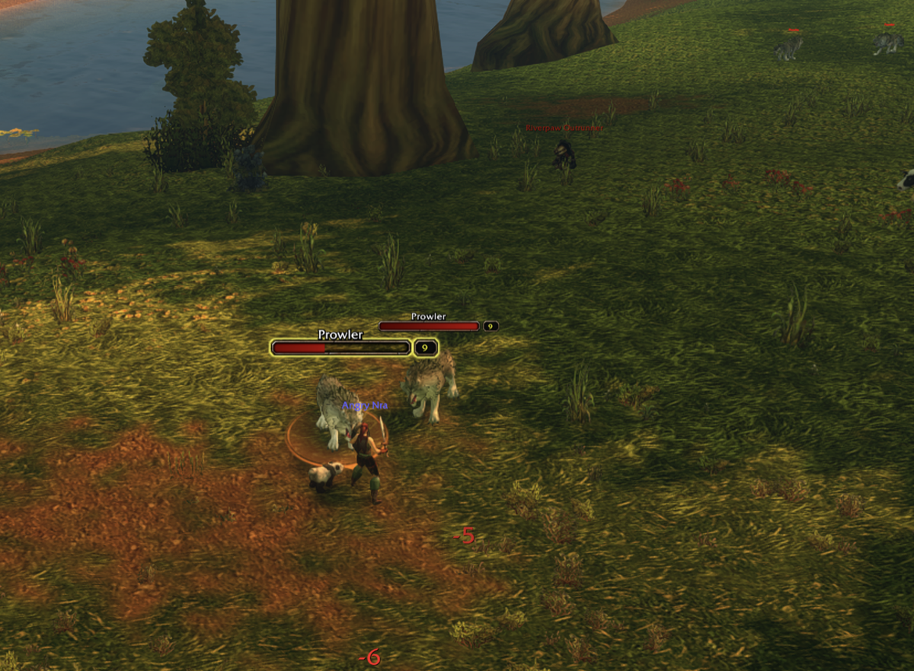
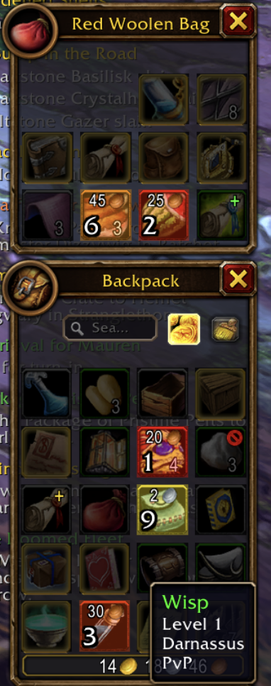
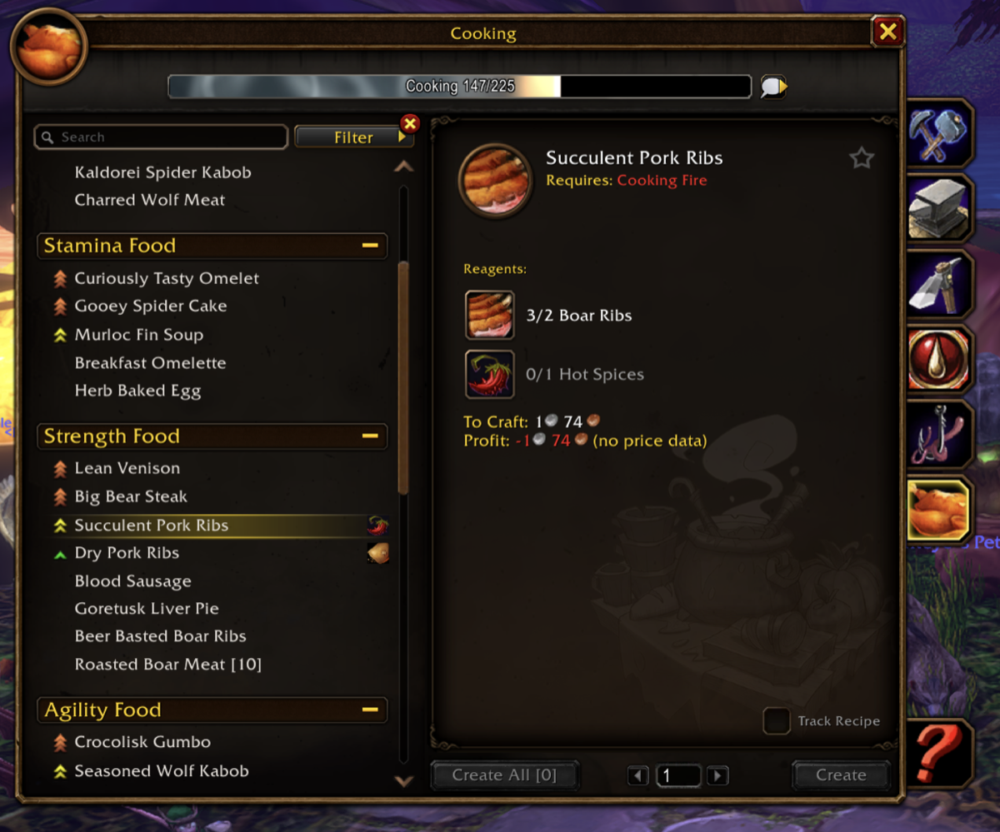
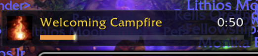
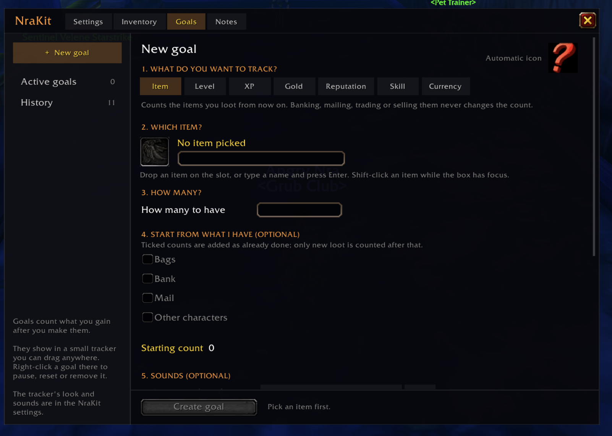
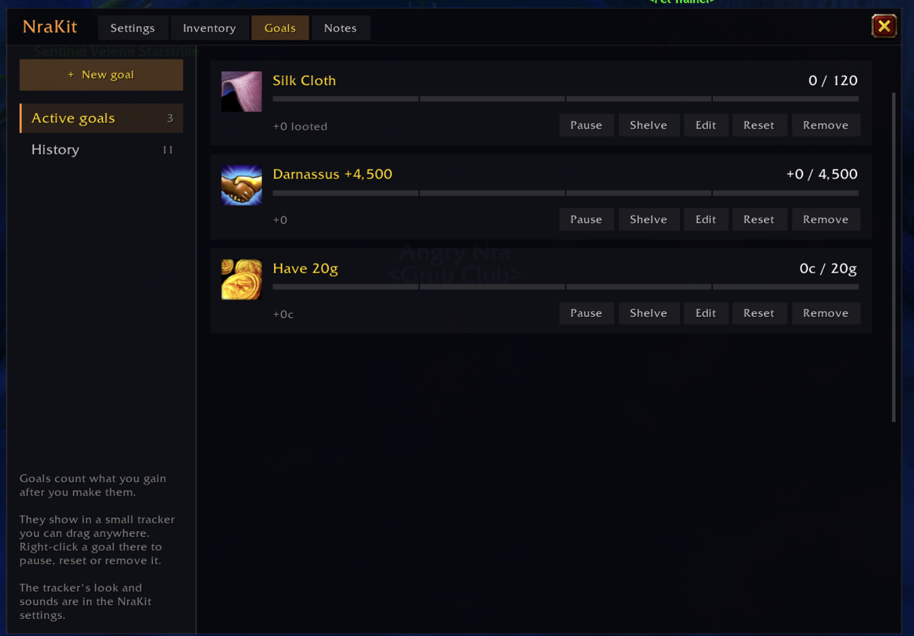
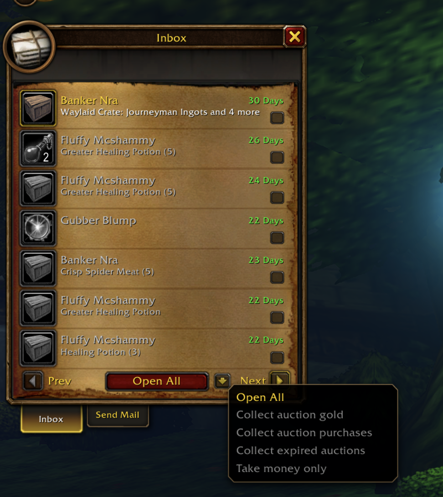
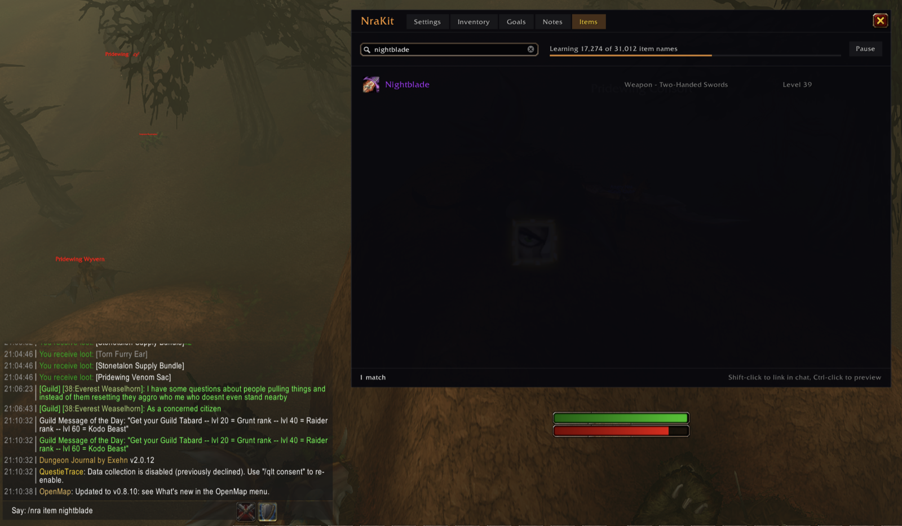
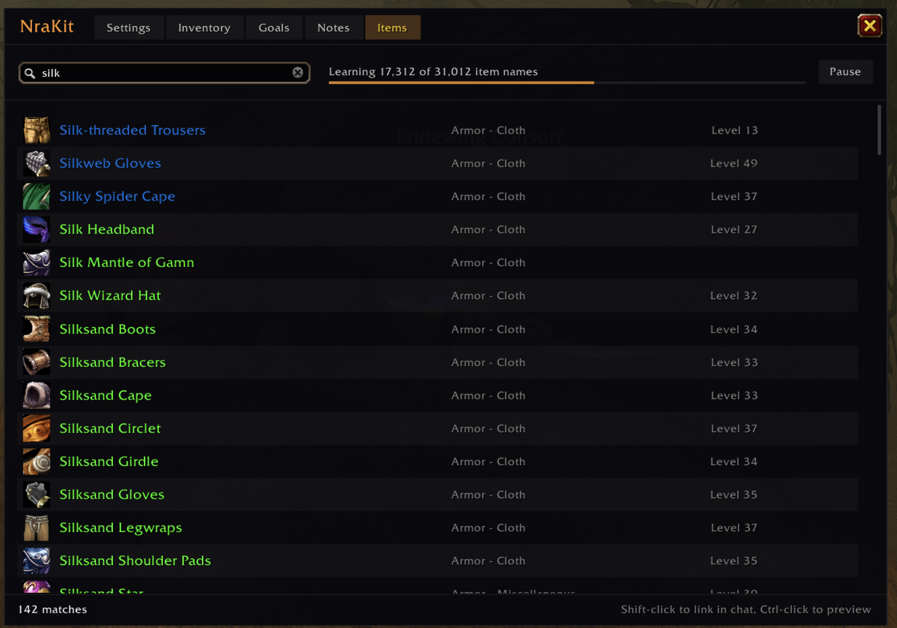

# NraKit

**Small quality-of-life tweaks for WoW Forever. Every feature is off by default, so turn on only what you want.**

Type **/nrakit** (or **/nra**) to open NraKit's own window: features grouped in a sidebar, **search**, an on/off switch per feature and its options right underneath. Everything is off until you turn it on. The same settings are also under **Options → AddOns → NraKit**. NraKit's windows (Settings, Inventory, Goals, Notes, Items) work as **tabs of one window**. Tabs of features that are off are dimmed: they say what the feature does and **turn it on with one click**. NraKit is also in the **addon button by the minimap** (no extra minimap button): left-click for settings, right-click for a menu of its windows. **/nra help** lists the chat commands, and **/nra preview** shows any of NraKit's on-screen messages (goal complete, quest reminders, alerts...) with made-up content, to see how they look.

**What's new** (**/nra new**, at the top of the NraKit window) shows what changed in every version, and new features can be turned on right there. After an update, NraKit tells you in one chat line (you can turn that off). It also tells you when a **newer version is out**, if someone in your guild or group already has it, and **/nra who** lists who in your guild and group runs NraKit (and how many NraKit users you've come across) (both can be switched off).

Alert **sounds are yours to choose** (Campfire timer, Unit Scanner, Farm goals, Player notes): a short list of good ones (hover to hear them), or **More sounds...** to search every game sound and any sounds other addons share through LibSharedMedia.

## Features

### Class-colored health bars
Your player, target, target-of-target, focus and party frames show **class-colored health bars** for players. NPCs keep their normal colors.

### Engaged-only nameplates
See plates only for the enemies that are actually fighting you.
- Full nameplates **only for enemies attacking you** (optionally also your party/raid).
- Every other enemy is hidden, so no more wall of health bars from mobs you aren't fighting.
- Optionally keep idle enemies' **names**, styled like the game's own overhead names, with adjustable size, height, outline and shadow.
- Optionally turns enemy nameplates **on when you enter combat and off when you leave it**, so you get clean overhead names while questing. (Forever's own "Always Show Nameplates" setting doesn't limit plates to combat at the moment.) If you turn enemy nameplates on yourself (V), they stay on.
- Your target, focus and enemy players always get full nameplates.

### Most valuable quest reward
When a quest lets you choose a reward, a **gold coin** marks the one that sells to a vendor for the most gold (sell price × stack size).

### Quest level
Shows the **quest's level in front of its title** in the quest dialog and quest details, like **[24] The Defias Brotherhood**, colored by difficulty just like the quest log.

### Quests to turn in
Running around with finished quests you forgot about? **/nra done** (or a key under Key Bindings → NraKit) shows a **small list of your finished quests by the zone you turn them in**, the zone you're in first, then the **nearest**.
- **Click** a quest to open the map on it (its turn-in shows there, and the list stays open), **right-click** it or click its **round quest icon** (as in the objective tracker) to make it your **waypoint**, **Shift+click** to link it.
- Entering a zone where you have quests to turn in **pops a small message** (click it to open the list; a chat line is optional), and can open the list itself (off by default).

### Bag Tithe
Find out what to throw away when your bags are full.
- A button next to the bag sort button **highlights your least valuable slots** (sell price × stack size), ranked from red to yellow, with rank numbers and sell values.
- Everything else is dimmed; your bags work as normal underneath.
- **Alt+click** an item to leave it out of the ranking. The ignore list can be edited in the options.

### Potential Upgrades
**Arrows on bag items and quest rewards**, plus a tooltip line, for items that beat what you're wearing.
- **Green**: clear upgrade. Usable now and at least as good on every stat that matters for your class (plus armor or weapon DPS).
- **Yellow**: likely upgrade, using a simple per-class stat priority.
- **Grey**: an upgrade once you reach the required level.

### Known recipes
No more mousing over every recipe at a vendor. Recipes you **already know get a green check** and a greyed-out icon at vendors, and a check in your bags.
- Optionally marks recipes for your professions that you **can learn now (green +)** or **once your skill is high enough (yellow +)**.
- Works for anything the game calls "Already known".
- Optionally makes **Bag Tithe** rank known recipes as junk.

### Inventory Tracker
Where did I put that? **Item tooltips show how many each of your characters has**, and where: bags, bank, mail or equipped, plus a total.
- Visit the bank and mailbox once on each character so they're known; after that they stay up to date.
- Items you **mail to your own characters** show up on them right away.
- **Inventory browser** (**/nra inv** or a key binding): every character with level and gold, their **bags, bank, mail and equipped** items as a bag-style grid or a list, with **search**, category filters (gear, consumables, trade goods, recipes, quest), how fresh each location is, and the **vendor value** of what's shown.
- **All characters** view lists who has what. Right-click a character to forget it.

### Open Clams
A small button at the bottom of your bags, next to your money, **opens the next clam** (or any other "Right Click to Open" container, except locked boxes) **one click at a time**, and shows how many are left.
- Can be **bound to a key** (Key Bindings → NraKit).
- Openable items get a **green border** in your bags.

### Sous Chef
Have the meat but not the spices? In the cooking window, recipes where you have the **main ingredient** but are missing **vendor-bought extras** (spices, water, flour...) show an icon of **what to buy and how much**.
- Tooltips on main ingredients list what they cook into and what's missing.
- Optionally only for recipes that still give skill, and optionally for all professions.

### Double-click fishing
With a **fishing pole in your main hand**, **double right-click** the world to cast Fishing. Right-clicking NPCs and players, and holding right-click to turn the camera, work as normal. The double-click time is adjustable.

### Unspent talent points
A **reminder in the middle of the screen** while you have talent points to spend. Size and position are adjustable, and it can hide in combat.

### Campfire timer
A **progress bar in the middle of the screen** while you rest at a Welcoming Campfire, with the time left. It turns green (with a sound) when Camp Benefits is ready.
- Width and position are adjustable.
- **/nra campfire** shows a 10-second preview.

### Farm goals
Just want to farm something? Set a goal like **loot 4000 Silk Cloth**, **reach level 40**, **gain 50,000 XP**, **earn 100 gold**, **reach Revered with a faction**, **get Swords to 300** (or to whatever your cap is) or **collect a currency**, and a small **movable tracker** shows the progress, how much you've gained, your **rate per hour** and **time left**.
- Progress bars are **marked at 25/50/75%**, optionally with a chime and a small message when you pass them. A **fanfare** and a big message in the middle of the screen when a goal is done (shown again after the fight if you finished it in combat). The finished goal **glows in the tracker** until you hover it.
- Finished? **Click** it to clear it to the history (you can restore it), or right-click to **go again** (another run of the same amount) or set a new target.
- Item goals count **what you loot**, so banking, mailing or selling never throws them off.
- Optionally **start from what you already have**: bags, bank, mail and other characters (with a live preview).
- Three tracker views: **Full**, **Compact** (one line per goal) and **Icons** (a tile per goal with a bar and the amount, as small as one icon, growing sideways up to 3 per row; the buttons appear on hover). Pick one from the arrow menu in the tracker's header (which can also lock it in place).
- Right-click a goal to pause, **edit**, **shelve** (hide it from the tracker, paused, until you bring it back), reset or remove it. Edit fixes the target, item, starting count or sounds without starting over.
- **/nra goal** opens the goals window (new goal, active and shelved goals, history). Or add goals from chat: **/nra goal 4000** plus a shift-clicked item, **/nra goal level 40**, **/nra goal gold 1g 50s**, **/nra goal rep revered timbermaw**, **/nra goal skill swords**, **/nra goal currency 2000 honor**... (**/nra goal help** lists them all).
- Each goal can have **its own sounds** for milestones and for finishing.
- **Icons** follow what a goal tracks (an axe for Axes, a pick for Mining, coins for gold), or **pick your own** like a macro icon: click the icon in the goal form and choose one, or drop an item or spell on it.

### /leave leaves your group
Type **/leave** (with nothing after it) or **/leavegroup** to leave your party, raid or instance group. **/leave &lt;channel&gt;** still leaves a chat channel.

### Mail
Helpers for the mailbox, each one an option (all on once you turn **Mail** on):
- **Open selected mail**: a **checkbox on each mail** in your inbox. Tick the ones you want and the **Open All** button becomes **Open Selected**, opening only those.
- **Open All menu**: an **arrow next to Open All** with more ways to open, each showing how many mails and how much gold first: **Collect auction gold** (sales and outbid refunds), **Collect auction purchases**, **Collect expired auctions** (unsold and cancelled), and **Take money only** (the gold from every mail, items left in). Gold works even with full bags; C.O.D. and GM mail are never touched.
- **Fill in mail subject**: the **subject** of a mail you're sending is written from **what you attach**: "Linen Cloth (40)", "Linen Cloth (40), Wool Cloth (20)", "25g" or "Linen Cloth (20) + 5g". A subject you typed yourself is never replaced.
- **Remember mail recipient**: the **To** box **keeps the name after you send** a mail, so sending several mails to the same player (like your **bank alt**) needs no retyping. It can also fill in the **last player you mailed** when you open Send Mail.
- **Alt+click to attach all**: with Send Mail open, **Alt+click an item in your bags** to attach **every stack** of it you have (all your Silk Cloth, all 4 Small Red Pouches), as many as fit in the mail.

### Hide micro menu notifications
Hides the blue notification dot on the **Shop** button that never goes away, and makes the **Legacy** button's dot show only when you have **unspent Legacy points**, not for every new challenge.

### Item lookup
**Search every item in the game by name.** **/nra item nightbl** opens an **Items** tab listing every item whose name contains it, best matches first, with icon, type, required level and how many your characters have (with Inventory Tracker). Hover for the tooltip, **Shift+click** to link it in chat, **Ctrl+click** to preview it.
- The game can't search items by name, so NraKit learns the names in the background, a few dozen a second (paused in combat). It takes a few minutes, once per game version; searching works right away and finds more as it fills.
- A **progress bar** in the tab shows how far it is, with **Pause / Resume**, and **Check again** once it's done.
- Items nobody has discovered yet can't be looked up until they have been; NraKit checks for them again every day (or right away with Check again).

### Inspect anything
**One key** (Key Bindings → NraKit) inspects **your target** (or whatever is **under your mouse** when you have none), in a window like the inspect window that **stays open until you close it**, even when they run off or you change target.
- **Players**: their **gear** around the model (tooltips, Shift+click to link), **spec and item level**. Inspected in combat, their gear **fills in after combat**. **Blizzard's inspect** opens the game's own window (talents, PvP, guild) while they're near, and **Dressing room** tries their outfit on.
- **NPCs**: their **3D model** to look at (**drag to turn**, **right-drag to move**, **mouse wheel to zoom**), level, type, health and attack speed, and an **Abilities on Wowhead** button (the game doesn't tell addons what NPCs can do, so it gives you their Wowhead link).
- Also in the **right-click menu** of NPCs and enemy players: **View 3D model** (optional).

### Copy Wowhead link
Hover an **item, spell, NPC, quest, achievement or currency** and press **Ctrl+C**. A box opens in the middle of the screen with its **wowhead.com/forever** link selected; copy it with **Ctrl+C** (**Cmd+C** on a Mac) and the box closes (addons can't reach the clipboard directly).
- Works on bag items, chat links, NPCs in the world, the quest log, achievements and the objective tracker.
- Ctrl+C is bound on first use if it's free; change it under Key Bindings > NraKit.

### Unit Scanner
Get alerted when a **mob or player from your own list** shows up.
- **Sound, on-screen text, chat line** and a flashing taskbar icon, each optional.
- Found units get a **raid marker** (Moon by default), and a **button to target them** with one click or a keybind.
- Target a unit and type **/nra scan** to add it (again to remove it), or use **/nra scan &lt;name or NPC ID&gt;**, **/nra scan list**, **/nra scan remove &lt;# or name&gt;** and **/nra scan clear**.
- Units are found through nameplates, mouseover, your and your group's targets, **minimap markers** (rares) and **NPC yells and emotes**. The nameplate range can optionally be raised while scanning.
- Addons can only see units the game already shows you, so keep enemy nameplates on (with Engaged-only nameplates, the scanner keeps them on for you).
- With **Player notes**, it also alerts you when a player you've labelled **Kill on sight** shows up (optional, on by default).

### Player notes
Remember who stole your mining node, who ninja'd the loot and who was a great healer.
- Give a player a **label** (Kill on sight, Avoid, Neutral, Good, Friend, or your own) and keep a **dated log of notes** on them (each note saves the date, zone and your character).
- Their label and latest note show in their **tooltip**.
- **Right-click a player** (portrait, party frame, their name in chat, guild and friends lists) for **Player note...** or to set their label right there.
- **Warnings** when a player labelled Avoid or Kill on sight joins your group, invites you, whispers you or opens a trade (chat, on screen and a sound, each optional).
- Labels can be renamed, recolored, added and deleted. Each has a **tone** that decides what it does: Hostile (warnings and Unit Scanner alerts), Caution (warnings), Neutral or Friendly (tooltip only).
- **/nra note** opens your notebook (**+ Add player** adds anyone by first name and surname, or your target; search by name, label or note text), or your target's notes. From chat: **/nra note Bob Stone kos stole my node**, and with a player targeted just **/nra note ninja'd the loot** (or **/nra note avoid ninja'd the loot** to label them too). **/nra note !remove** takes your target out of your notes (**!undo** brings them back).

## Feedback and bugs
NraKit is a growing collection of small fixes. Found a bug or have an idea? **[Open an issue on GitHub](https://github.com/repsejnworb/NraKit/issues).**

Source code: [github.com/repsejnworb/NraKit](https://github.com/repsejnworb/NraKit) (MIT license)
