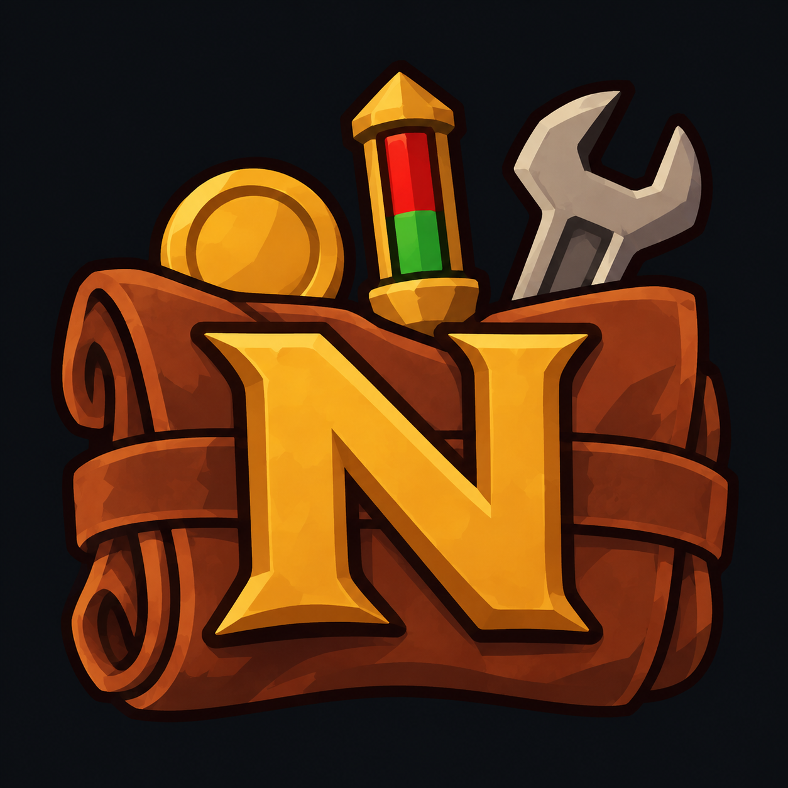

  

# NraKit

A WoW Forever addon with a collection of small quality-of-life tweaks. Every feature is
**off by default**, so turn on only what you want.

## Install
Clone or symlink this repo into `World of Warcraft/_<flavor>_/Interface/AddOns/NraKit`
(the folder name must be `NraKit`).

## Settings
Type `/nrakit` (`/nra`) to open NraKit's window: features grouped in a sidebar, a search box, an
on/off switch per feature and its options right underneath. Everything is off until you turn it on.
The same settings are also in the game's Settings panel under **AddOns → NraKit**.
NraKit's windows (Settings, Inventory, Goals, Notes) work as tabs of one window, with a tab for each
feature you have on. NraKit is also in the addon button by the minimap: left-click for settings,
right-click for a menu of its windows. **What's new** (`/nra new`, top of the NraKit window) lists what changed in each
version, and new features can be turned on right there. After an update, NraKit says so in one chat line.
It also tells you when a newer version is out, if someone in your guild or group already has it (NraKit
shares its version with other NraKit users there; switch it off on the What's new page). `/nra who` lists
who in your guild and group runs NraKit, which version, and how many NraKit users you've come across
(this session and in all). `/nra help` lists the chat commands; add `help` after one for details
(e.g. `/nra goal help`).

Sounds (Campfire timer, Unit Scanner, Farm goals, Player notes) can be changed: pick from a short list of good
ones (hover to hear them) or **More sounds...** to search every game sound, plus any sounds other
addons share through LibSharedMedia.

## Features
- **Class-colored health bars**: player, target, target of target, focus and party frames
  show class-colored health bars when the unit is a player. NPCs keep the default color.
- **Engaged-only nameplates**: shows full nameplates only for enemies that are actually
  fighting you (optionally your group). Other enemy NPCs are hidden (in or out of combat), or
  optionally show just their name, styled like the game's own overhead names. Target, focus
  and enemy players always get full plates. Optionally turns enemy nameplates on when entering
  combat and off when leaving it; if you turned them on yourself (V key), they stay on. Hidden
  plates can still be clicked where their bar would be, because addons can't change a plate's
  click area during combat.
- **Mark most valuable quest reward**: when a quest offers a choice of rewards, a gold coin
  marks the one that sells to a vendor for the most gold (vendor price × stack size).
- **Show quest level**: the quest's level in front of its title in the quest dialog and quest
  details, e.g. "[24] The Defias Brotherhood", colored by difficulty like the quest log.
- **Bag Tithe**: a button next to the bag sort button (separate or combined bags) highlights
  your least valuable bag slots (vendor price × stack size), ranked from red to yellow, with
  rank numbers and sell values. Everything else is dimmed; the bags work as normal underneath.
  Alt+click an item to leave it out of the ranking; the ignore list is editable in the options.
- **Potential Upgrades**: arrows on bag items and quest rewards, plus a tooltip line, for items
  that beat what you have equipped. Green = clear upgrade (usable now and at least as good on every
  stat that matters for your class, plus armor or weapon DPS). Yellow = likely upgrade (better by a
  simple per-class stat priority). Grey = upgrade once you reach the required level.
- **Known recipes**: recipes you already know get a green check at vendors (with a greyed-out icon)
  and in your bags, so you don't have to mouse over each one. Works for anything the game calls
  "Already known". Optionally marks recipes for your professions you can learn now (green +) or once
  your skill is high enough (yellow +), and can make Bag Tithe rank known recipes as junk.
- **Inventory Tracker**: item tooltips list how many of the item each of your characters has and
  where, e.g. "Bob 12 (Bags 5, Bank 7)", with a total. Bags and equipment are tracked as they change;
  the bank and mailbox are read while open, so visit them once per character. Items you mail to your
  own characters show up in their mail right away.
  `/nra inv` (or a key binding) opens the **inventory browser**: every character in a sidebar with
  level and gold, their bags, bank, mail and equipped items as a bag-style grid or a list, search,
  category filters, how fresh each location is, and the vendor value of what's shown. "All
  characters" lists who has what. Right-click a character to forget it.
- **Open Clams**: a button at the bottom left of your bags (next to your money) opens the next clam (or any other
  "Right Click to Open" container, except locked boxes) one per click, showing its icon and how
  many are left. Bindable under Keybindings → AddOns → NraKit. Openable items get a green border.
- **Sous Chef**: in the cooking window, recipes where you have the main ingredient (the meat,
  fish...) but are missing vendor-bought secondaries (spices, water, flour...) get an icon of what
  to buy, and the row tooltip says how much. Item tooltips on a main ingredient list what it cooks
  into and what's missing. Vendor items are recognised from a built-in list plus what you see at
  merchants. Open cooking once per character so it knows your recipes. Optionally all professions.
- **Unspent talent points**: a reminder in the middle of the screen while you have talent points
  to spend (hidden while dead and, optionally, in combat). Size and position are adjustable.
- **Campfire timer**: a progress bar in the middle of the screen while you rest at a Welcoming
  Campfire, with the time left. It turns green (with a sound) when Camp Benefits is ready. Width
  and position are adjustable; `/nra campfire` shows a 10-second preview.
- **Farm goals**: set goals like "loot 4000 Silk Cloth", "reach level 40", "gain 50,000 XP",
  "earn 100 gold", "reach Revered with Timbermaw Hold", "Swords to 300 (or to its cap)" or a
  currency amount (reach a level or gain an amount), and track them in a small movable window: progress bar, amount gained, rate per
  hour and time left; the bars are marked at 25/50/75% (optionally with a chime and a small message
  there). A fanfare and a big message in the middle of the screen
  when a goal is done (shown again after the fight if it happened in combat); the finished goal glows
  in the tracker until you hover it. Click a finished goal to clear it to the history (Restore brings
  it back), or right-click it to **go again** (another run of the same amount) or set a new target. Item goals count what you loot (banking, mailing or selling never changes
  them) and can start from what you already have in your bags, bank, mail or on other characters.
  The tracker has three views (pick one from the arrow menu in its header, which also locks the tracker): **Full**, **Compact** (one line
  per goal) and **Icons** (a tile per goal with a bar and the amount; the box is just the tiles, growing
  sideways up to 3 per row, with the buttons appearing above it on hover). Right-click a goal to pause,
  edit, **shelve** (hide it from the tracker, paused, until you bring it back from the goals window),
  reset or remove it. **Edit** fixes a goal's target, item, starting count or sounds without starting
  over, and each goal can have its own milestone and finish sounds.
  `/nra goal` opens the goals window (new goal, active and shelved goals, history). Goals can also be
  added from chat: `/nra goal 4000 [item]`, `/nra goal level 40`, `/nra goal gold 1g 50s`, `/nra goal rep revered timbermaw`,
  `/nra goal skill swords`, `/nra goal currency 2000 honor`, ... (`/nra goal help` lists them all).
- **/leave leaves your group**: type `/leave` (with nothing after it) or `/leavegroup` to leave
  your party, raid or instance group. `/leave <channel>` still leaves a chat channel.
- **Open selected mail**: a checkbox on each mail in your inbox. Tick some and the Open All button
  turns into "Open Selected (N)" and only opens those. The selection is cleared when you close the mailbox.
- **Hide micro menu notifications**: hides the blue "new" dot on the Shop button, and shows the
  Legacy button's dot only while you have unspent Legacy Tree points (not for every new challenge).
- **Copy Wowhead link**: hover an item, spell, NPC, quest, achievement or currency and press Ctrl+C.
  A box opens in the middle of the screen with its wowhead.com/forever link selected; copy it with
  Ctrl+C (Cmd+C on a Mac) and the box closes (addons can't reach the clipboard directly). Works in bags, chat links, quest log, achievements and the
  objective tracker. Ctrl+C is bound on first use if it's free; change it under Key Bindings > AddOns.
- **Unit Scanner**: alerts you (sound, on-screen text, chat line, taskbar flash) when a mob or
  player from your list shows up in nameplate range, on mouseover, as your target, focus or a group
  member's target, as a minimap marker (rares), or when an NPC yells, says or emotes. Optionally
  raises the nameplate range while scanning. Found units get a raid marker (Moon by default) and a
  button with the marker and their name: click it (or its keybind) to target them, right-click to
  dismiss, Shift-drag to move. Target a unit and type `/nra scan` to add or remove it, or use
  `/nra scan <name or NPC ID>`, `/nra scan list`, `/nra scan remove <# or name>` and
  `/nra scan clear`. Addons can only see units the game already shows you, so enemy nameplates
  should be on (with Engaged-only nameplates, the scanner keeps them on while the list isn't empty).
  With Player notes, it also alerts for players labelled Kill on sight (optional, on by default).
- **Player notes**: give players a label (Kill on sight, Avoid, Neutral, Good, Friend, or your own)
  and a dated log of notes (each saves the date, zone and your character). Their label and latest note
  show in their tooltip. Right-click a player (portrait, party frame, chat name, guild and friends
  lists) for **Player note...** or to set their label. Warns you (chat, on screen, sound) when a player
  labelled Avoid or Kill on sight joins your group, invites, whispers or trades you. Labels can be
  renamed, recolored, added and deleted; each has a tone that decides what it does: Hostile (warnings
  and Unit Scanner alerts), Caution (warnings), Neutral or Friendly (tooltip only). `/nra note` opens
  the notebook (**+ Add player** adds anyone by first name and surname; search by name, label or note text) or your target's notes; from chat,
  `/nra note Bob Stone kos stole my node` and with a player targeted just
  `/nra note ninja'd the loot` (or `/nra note avoid ninja'd the loot` to label them too).
  `/nra note !remove` takes your target out of your notes (`!undo` brings them back).

## Development
Requires [just](https://github.com/casey/just), [cocogitto](https://github.com/cocogitto/cocogitto) and Lua (`luac` for the syntax check; LuaJIT for the tests, since it runs Lua 5.1 like the game).
Commits follow [Conventional Commits](https://www.conventionalcommits.org/).

- `just check` syntax-checks the Lua files
- `just test` runs the tests: the addon is loaded into a stand-in WoW client (`tests/wow.lua`) and its
  windows are clicked through (`tests/*_test.lua`). They also run on every push (GitHub Actions)
- `Changelog.lua` is the player-facing changelog (in game under What's new, and the release notes): add a line
  under `Unreleased` with every change players will notice
- `just next` shows the next version, the commits going into it and whether the changelog has them
- `just release` turns `Unreleased` into the next version, writes `CHANGELOG.md`, tags and pushes; CI packages it
  and uploads to CurseForge and GitHub
- `just release-pre alpha.1` does the same as an alpha/beta pre-release

## License
[MIT](LICENSE)
