

  

# NraKit

A WoW Forever addon with a collection of small quality-of-life tweaks.

Every feature is **off by default**, so turn on only what you want.

## Install

Clone or symlink this repo into `World of Warcraft/_<flavor>_/Interface/AddOns/NraKit`
(the folder name must be `NraKit`).

## Getting Started

### The NraKit Window

Type `/nrakit` (or `/nra`) to open NraKit's window.

- Features are grouped in a sidebar, with a search box, an on/off switch per feature and its options
  right underneath.
- The same settings are also in the game's Settings panel under **AddOns → NraKit**.
- NraKit's windows (Settings, Inventory, Goals, Notes, Items, Wishlist, Reminders & To-Do) work as **tabs of one window**. Tabs of
  features that are off are dimmed: they say what the feature does and turn it on with one click.
- NraKit is also in the **addon button by the minimap**: left-click for settings, right-click for a
  menu of its windows.

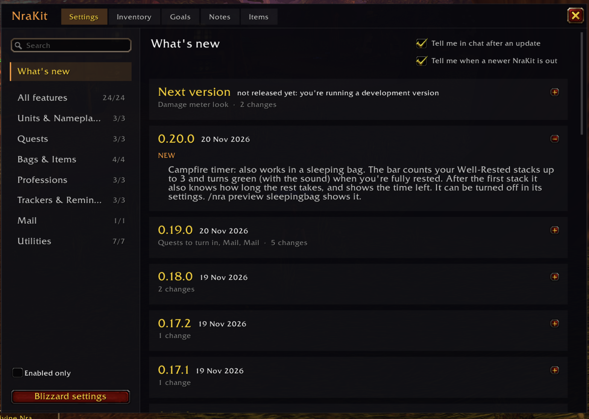

### What's New and Updates

- **What's New** (`/nra new`, at the top of the NraKit window) lists what changed in each version, and
  new features can be turned on right there.
- After an update, NraKit says so in one chat line.
- It also tells you when a **newer version is out**, if someone in your guild or group already has it.
  NraKit shares its version with other NraKit users there; switch it off on the What's New page.
- `/nra who` lists who in your guild and group runs NraKit, which version, and how many NraKit users
  you've come across (this session and in all).

### Chat Commands

- `/nra help` lists the chat commands; add `help` after one for details (e.g. `/nra goal help`).
- `/nra preview` shows any of NraKit's on-screen messages (goal complete, quest reminders, alerts...)
  with made-up content, to see how they look (e.g. `/nra preview goal`).
- `/nra debug` lists the features that can log what they do, to report a problem: `/nra debug sell`
  turns one on, `/nra debug copy` shows the last lines in a box to copy, `/nra debug off` stops it.

### Sounds

Alert sounds (Campfire Timer, Unit Scanner, Farm Goals, Player Notes, Reminders & To-Dos) can be changed:

- Pick from a short list of good ones (hover to hear them).
- Or use **More sounds...** to search every game sound, plus any sounds other addons share through
  LibSharedMedia.

## Features

Grouped as in the NraKit window.

### Interface

#### Class-Colored Health Bars

Player, target, target of target, focus and party frames show **class-colored health bars** when the
unit is a player. NPCs keep the default color.

#### Engaged-Only Nameplates

Full nameplates only for enemies that are **actually fighting you** (optionally your group too).

- Other enemy NPCs are hidden (in or out of combat), or optionally show just their name, styled like
  the game's own overhead names.
- Target, focus and enemy players always get full plates.
- Optionally turns enemy nameplates **on when entering combat and off when leaving it**. If you turned
  them on yourself (V key), they stay on.
- Hidden plates can still be clicked where their bar would be, because addons can't change a plate's
  click area during combat.

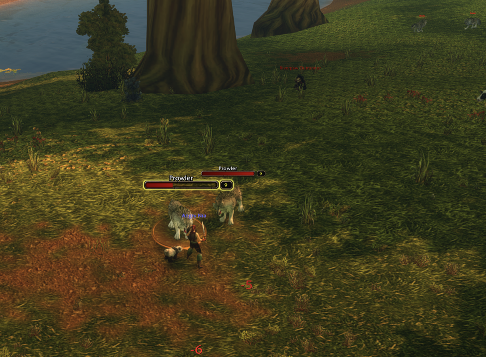

#### Cooldown Manager Fade

The game's **Cooldown Manager** bars show in combat and **fade out a while after it**, animated,
instead of just vanishing.

- Set the bars to **Always** in Edit Mode: one set to "In combat" is hidden by the game before it can
  fade. Visible is the bar's own Edit Mode opacity.
- Pick **which bars**: Essential Cooldowns and Utility Cooldowns (on by default), Tracked Buffs and
  Tracked Bars.
- **Stay after combat** (10 seconds), **Fade over** (2 seconds) and **Faded opacity** (0%, or a
  faint trace).
- They also come back with a **hostile target** (lining up a pull), fading right away when you drop
  it, and while the **mouse is over** a bar. Each is an option.
- Every change is animated: fading in is quick, but never a jump.

#### Damage Meter Look

A **clean, flat look** for the game's own damage meter.

- The header becomes a thin dark strip with a small gold title and small grey buttons (optionally only
  while the mouse is over the meter).
- The bars get a flat fill in a softer class colour, with outlined text.
- Size, style, icons and class colours are still set in Edit Mode.
- Turning it off asks for a reload to bring back the game's look.
- `/nra dps` shows or hides the damage meter (the game's own setting), whether or not the look is on.
  `/nra dps show` and `/nra dps hide` do one or the other. With the meter's visibility set to
  **Always** in Edit Mode, `/nra dps` alone decides (NraKit doesn't change Edit Mode for you).

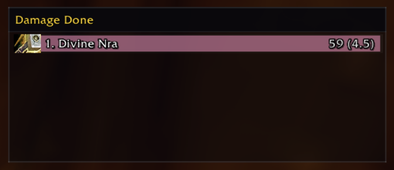

#### Hide Micro Menu Notifications

- Hides the blue "new" dot on the Shop button.
- Shows the Legacy button's dot only while you have unspent Legacy Tree points (not for every new
  challenge).

### Classes

#### Warrior

**Tactical Mastery mark:** the rage bar of the **Personal Resource Display** shows a small arrow at how much rage you **keep when you
change stance**: 10 from Tactical Mastery, plus 5 per rank of Improved Tactical Mastery. It follows what you've
learned and your talents by itself. The arrow sits at the top, bottom or both, at the size you like, and you can
shade the bar up to it.

**Proc alerts:** the game shows no proc glow for **Overpower, Revenge, Victory Rush and Execute**, so NraKit makes
their action buttons glow (the game's own proc glow) while you can use them. Bright means press it now; dim means
it's up but you're short of rage or it's on cooldown. A thin gold bar along the button drains as the proc runs out,
turning orange with the glow pulsing at the end; Victory Rush also counts down its seconds. Its time comes from its
buff; NraKit learns Overpower's and Revenge's the first time one runs out.
Optionally a sound, and the icon next to the Personal Resource Display's rage bar.

### Quests

#### Best Quest Reward

When a quest offers a choice of rewards, a **gold coin** marks the one that sells to a vendor for the
most gold (vendor price × stack size).

#### Quest Level

The quest's level in front of its title in the quest dialog and quest details, e.g.
"[24] The Defias Brotherhood", colored by difficulty like the quest log.

#### Quests to Turn In

`/nra done` (or a key under Key Bindings → NraKit) shows a small window listing your **finished quests
by the zone you turn them in**: the zone you're in first, then the nearest ("Wetlands (6): The Doomed
Fleet, ...").

- **Click** a quest to open the map on it (its turn-in shows there; the list stays open).
- **Right-click** it, or click its **round quest icon** (as in the objective tracker), to make it your
  waypoint.
- **Shift+click** to link it.
- Entering a zone where you have quests to turn in shows a **small message** (click it to open the
  list; a chat line is optional), and can open the window (off by default). The message lists them
  one per line (click one to open the list), together with your **to-dos** there (Reminders & To-Dos).

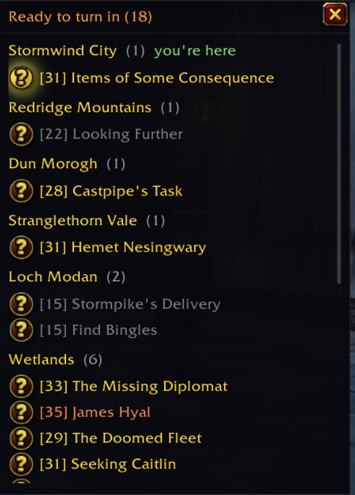
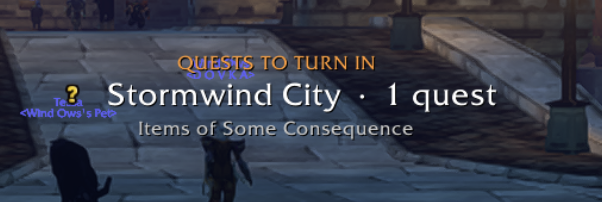

### Bags & Items

#### Bag Tithe

A button next to the bag sort button (separate or combined bags) **highlights your least valuable bag
slots** (price × stack size: the vendor's, or with Auctionator the auction house's when that's more,
so valuable trade goods aren't ranked as junk; soulbound items stay at vendor price).

- Ranked from red to yellow, with rank numbers and sell values.
- Everything else is dimmed; the bags work as normal underneath.
- **Alt+click** an item to leave it out of the ranking; the ignore list is editable in the options.

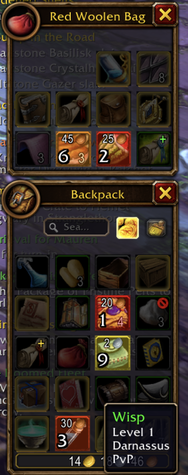

#### Potential Upgrades

Arrows on bag items and quest rewards, plus a tooltip line, for items that **beat what you have
equipped**.

- **Green:** clear upgrade. Usable now and at least as good on every stat that matters for your class,
  plus armor or weapon DPS.
- **Yellow:** likely upgrade, better by a simple per-class stat priority.
- **Grey:** an upgrade once you reach the required level.
- Green "Equip:" bonuses count too: attack power, spell power and healing, mana per 5, and chance to
  hit or crit, each at a rough worth for your class. Other effects (on use, procs, set bonuses) can't
  be judged, so items with them are never called clear.
- It's a clue while leveling, to help you decide, not an exact calculation.

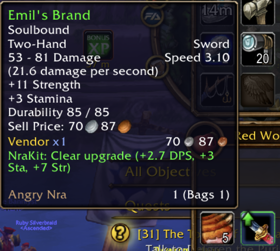

#### Inventory Tracker

Item tooltips list **how many of the item each of your characters has, and where**, e.g.
"Bob 12 (Bags 5, Bank 7)", with a total.

- Bags and equipment are tracked as they change. The bank and mailbox are read while open, so visit
  them once per character.
- Items you mail to your own characters show up in their mail right away.
- **Hover your gold** at the bottom of your bags to see the gold of each of your characters, and the
  total (an option).
- `/nra inv` (or a key binding) opens the **inventory browser**:
  - every character in a sidebar with level and gold;
  - their bags, bank, mail and equipped items, as a bag-style grid or a list;
  - search, category filters, how fresh each location is, and the vendor value of what's shown;
  - "All characters" lists who has what. Right-click a character to forget it.

#### Open Clams

A button at the bottom left of your bags (next to your money) **opens the next clam** one per click,
showing its icon and how many are left.

- Works for any "Right Click to Open" container, except locked boxes.
- Bindable under Key Bindings → NraKit.
- Openable items get a green border.

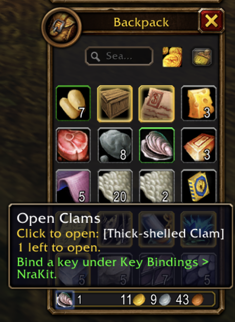

#### Wishlist

A **list of gear you want**, by slot, ticked off when you get it.

- Add items with `/nra wishlist <item> [note]` (shift-click the item in; anything after it becomes its
  note; shift-click several to add them all at once), by **right-clicking an item link in chat** or an item in Item Lookup, or by **dropping an
  item** on the window.
  `/nra wish` is short for it.
- The Wishlist tab lists them in a section per slot, with the **level to wear** each one (grey while
  it's above yours). Filter by **Ready** (you can wear it), **Not yet** or **Got**, or search names
  and notes.
- Click an item to write a **note** on where it comes from (NraKit has no database of sources).
  Right-click for got / not got, a Wowhead link, or remove.
- Items you have (bags, bank or worn) are **ticked off**, with a message when one lands in your bags.
  An option takes them off the list instead.
- A **star** marks wishlist items in your bags, at vendors, in quest rewards, the loot window, loot
  rolls and Item Lookup: gold while you want it, grey once you have it.
- Item tooltips say when an item is on your wishlist, with your note.
- `/nra preview wishlist` shows the message.

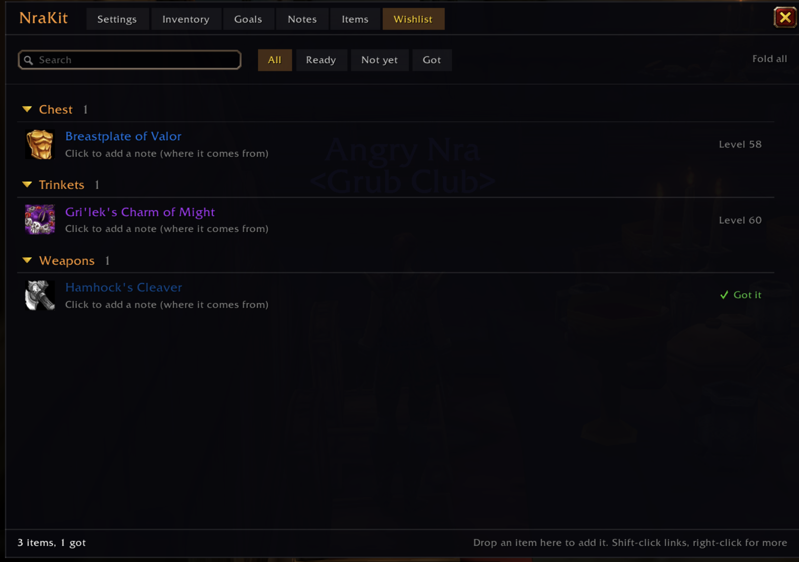
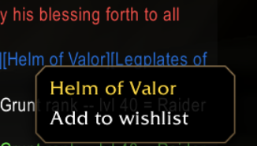
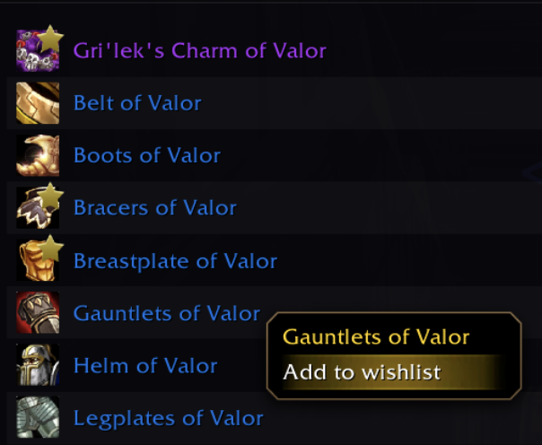

### Professions

#### Known Recipes

Recipes you **already know get a green check** at vendors (with a greyed-out icon) and in your bags,
so you don't have to mouse over each one.

- Works for anything the game calls "Already known".
- Optionally marks recipes for your professions you can learn now (green +) or once your skill is high
  enough (yellow +).
- Can make Bag Tithe rank known recipes as junk.

#### Sous Chef

In the cooking window, recipes where you have the **main ingredient** (the meat, fish...) but are
missing **vendor-bought extras** (spices, water, flour...) get an icon of what to buy, and the row
tooltip says how much.

- Item tooltips on a main ingredient list what it cooks into and what's missing.
- Vendor items are recognised from a built-in list plus what you see at merchants.
- Open cooking once per character so it knows your recipes.
- Optionally for all professions.

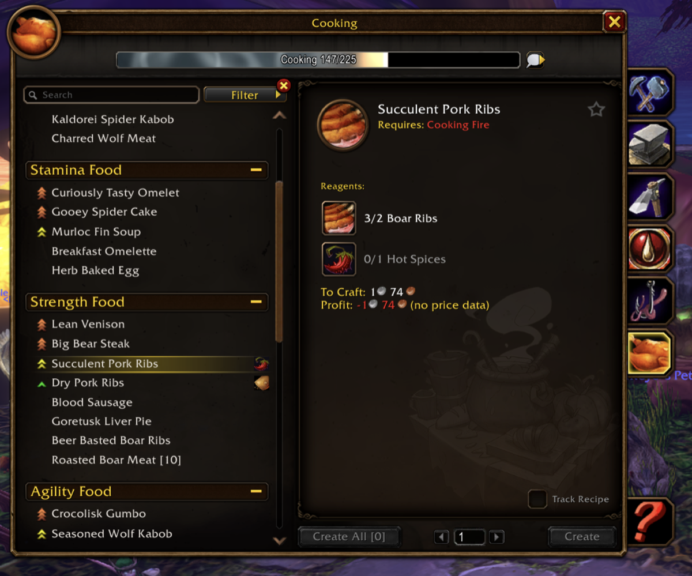

#### Double-Click Fishing

With a fishing pole in your main hand, **double right-click the world to cast Fishing** (your highest
rank).

- Right-clicking NPCs and players, and holding right-click to turn the camera, work as normal.
- The double-click time is adjustable.

### Auction House

#### Sell List

**What in your bags is worth selling**, the most valuable first, so you don't have to hover every
item. A tab in the NraKit window (`/nra sell`).

- **Vendor and auction house prices side by side** (auction prices from Auctionator), for each item
  and the whole stack. The better of the two is bright; "a vendor pays more" says when to vendor.
- An auction price **more than 3 days old** is marked, so you don't undercut yourself on old data.
- It **opens by itself** beside the auction house when you open it. Pick where in the **Automatically
  Open At** menu at the top of the list (or its settings): the auction house (on by default),
  merchants, the bank and the mailbox. **Per character**: your bank alt can open it at the bank,
  your main not. A **button on the auction house** opens it too. NraKit's
  window sits **right beside it**, whichever tab you go
  to, until the auction house closes. There, **Alt+click** an item to put it in **Auctionator's
  Selling tab** (Auctionator's own shortcut), or click it to pick it up and drop it in the sell
  slot. Also a **What can I sell?** button in the Inventory tab (on your own character).
- After a fresh scan it says **"Prices have changed"** by the **refresh** button, rather than
  reshuffling the list under your mouse.
- Split by where each item sells best: **To Sell: Auction House** and **To Sell: Vendor**
  (soulbound items too). At the auction house the vendor group starts folded. Right-click an item
  for **Keep, don't list** on potions, food and reagents you use.
- Optionally it also **opens at merchants**, docked beside them with the vendor group first: click an
  item, then the merchant's window, to sell it.
- **Bank** and **Mail** switches at the top list what's in your bank and mailbox too (as Inventory
  Tracker last saw them), mixed in by value but **marked**: a bank or mailbox badge on the icon, a
  row tint of their own (warm for the bank, blue for mail), and a note on what to do. The footer
  counts them apart: "+120g in bank & mail". Cash-on-delivery mail isn't listed: it isn't yours yet.
- A **Bags** switch next to them. At the bank or mailbox the list shows **just what's there** (you're
  there to take things out): clicking Bags, Bank or Mail there changes it for that visit only, and
  your own settings come back when you leave.
- **At the bank or mailbox** a **NraKit Sell List** button by the window's close button opens the
  list beside it, with that place always listed. **Click one to take it** into your bags. With more than one stack it asks
  how many (starting at what fits in your bags; **Take All**), Shift-click takes all that fits.
  From the bank it can take part of a stack; a mail's attachments come one at a time.
- Items you're still farming for a **Farm Goal** stay in their own folded group until the goal is done.
- Leaves out items worth less than a **minimum** (5 silver) and sorts by **any column**. The footer
  says what it's all worth.
- Without Auctionator it still works, on vendor prices.

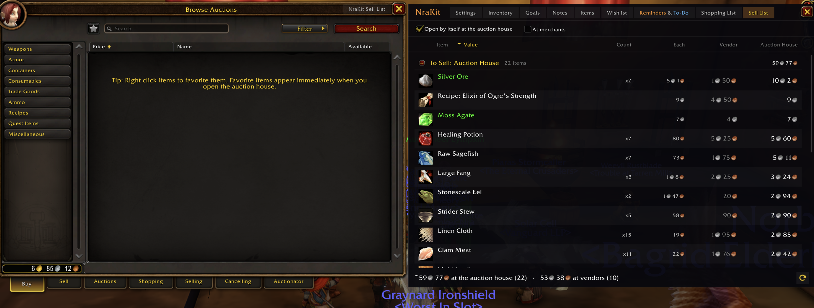

#### Auctionator Prices

Needs **[Auctionator](https://www.curseforge.com/wow/addons/auctionator)**. What things cost at
the auction house, from Auctionator's last scan.

- **Waylaid Crates:** a crate's tooltip shows **what each bundle it takes costs**, with the
  **cheapest in green**. An Auctionator shopping list, **"Waylaid Crates"**, holds every bundle of
  the crates in your bags, in the amounts they need (two crates, twice the amount). It's rewritten
  when your crates change, but not while the auction house is open. `/nra crates check` compares
  NraKit's crate list with the game's own tooltips (after a patch, say).
- **Recipes:** a recipe's tooltip (click a recipe link in chat) shows **what one craft costs**:
  each reagent and the total.
- **How many you have** of each reagent, on recipes and crates: on all your characters (with
  Inventory Tracker; else your bags and bank), **green** when your bags hold enough, **yellow** when
  you have enough elsewhere (bank, other characters), grey if not. When they aren't all in your
  bags, a line under it says **where**: "You 3 (Bags 2, Bank 1), Bankalt 12". A recipe also says
  what's left **to buy**.
- **Shopping lists:** right-click a recipe link in chat or a recipe in your profession window (or
  use the **Shopping List** button by its reagents) for:
  - **Create shopping list for this recipe**: an Auctionator list named after the recipe, with one
    craft's reagents.
  - **Add to NraKit Shopping List**: adds one craft's reagents to your big list.
- **The NraKit Shopping List** (`/nra shop`, a tab in the NraKit window): everything you're
  crafting, with what it's for, the **amount** (type it, or - and +), the price of one and of them
  all, and **how many you have** on all your characters (hover for who; needs Inventory Tracker,
  else your bags and bank). Remove items, or **Clear list** (it asks first). Auctionator gets a
  copy, **"NraKit Shopping List"**, kept up to date while you're away from the auction house; at
  it, **Search at AH** searches for everything.
- **Vendor items** (thread, dye, vials...) show the **vendor's price**, tagged "vendor": NraKit
  remembers what merchants you visit sell (Auctionator's vendor prices fill the gaps). They're left
  out of Auctionator lists (an option).
- **Inventory value:** the Inventory tab shows what each character's bags, bank and mail are worth
  at the auction house, and everyone's in all.
- Optionally shows the price per item too.

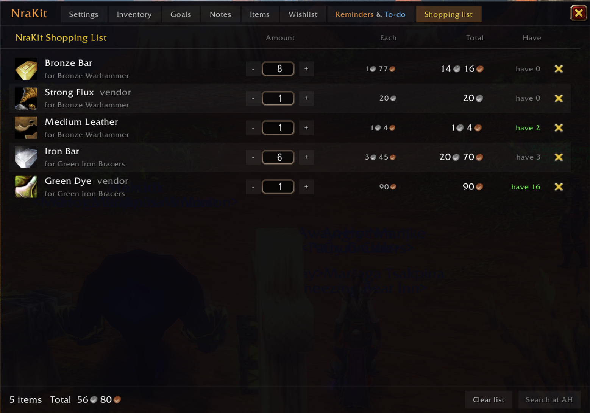
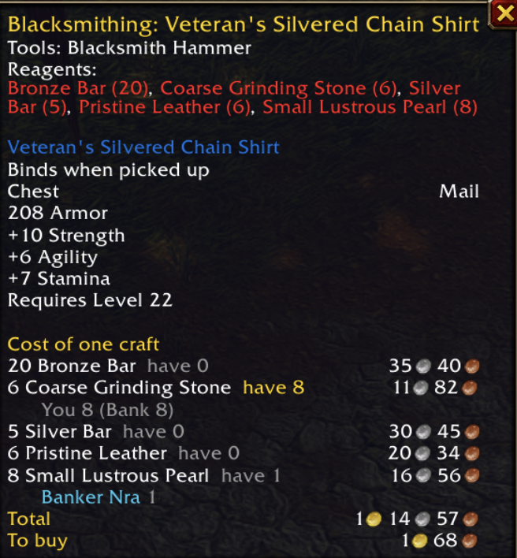
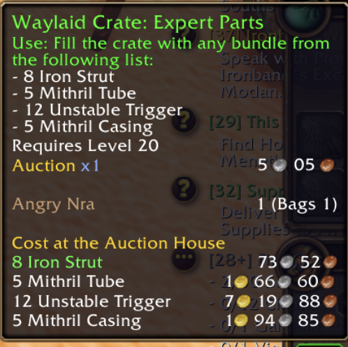
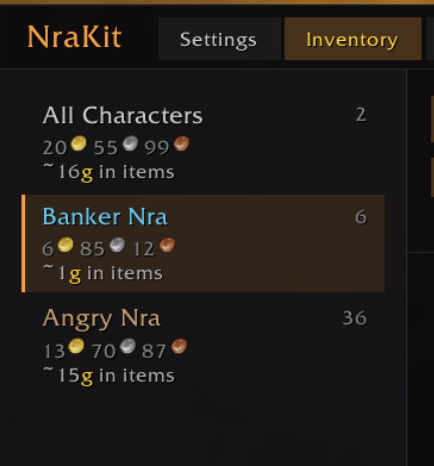

### Mail

Helpers for the mailbox. Each one is an option, and all are on once you turn Mail on.

- **Open selected mail:** a checkbox on each mail in your inbox. Tick some and the Open All button
  turns into "Open Selected (N)" and only opens those. The selection is cleared when you close the
  mailbox.
- **Open All menu:** an arrow next to Open All with more ways to open, each showing how many mails and
  how much gold first:
  - **Collect auction gold** (sales and outbid refunds);
  - **Collect auction purchases**;
  - **Collect expired auctions** (unsold and cancelled);
  - **Take money only** (the gold from every mail, items left in).

  Gold works with full bags; C.O.D. and GM mail are never touched.
- **Fill in mail subject:** the subject of a mail you're sending is written from what you attach, like
  "Linen Cloth (40)", "Linen Cloth (40), Wool Cloth (20)", "25g", "Linen Cloth (20) + 5g" or
  "Linen Cloth (20) (C.O.D. 5g)". A subject you typed yourself is never replaced.
- **Remember mail recipient:** the To box keeps the name after you send a mail, so you can send several
  to the same player (like your bank alt) without typing it again. The name is selected, so typing
  replaces it. Optionally the last player you mailed is filled in when you open Send Mail.
- **Alt+click to attach all:** with Send Mail open, Alt+click an item in your bags to attach every stack
  of it you have (all your Silk Cloth, all 4 Small Red Pouches), as many as fit in the mail.

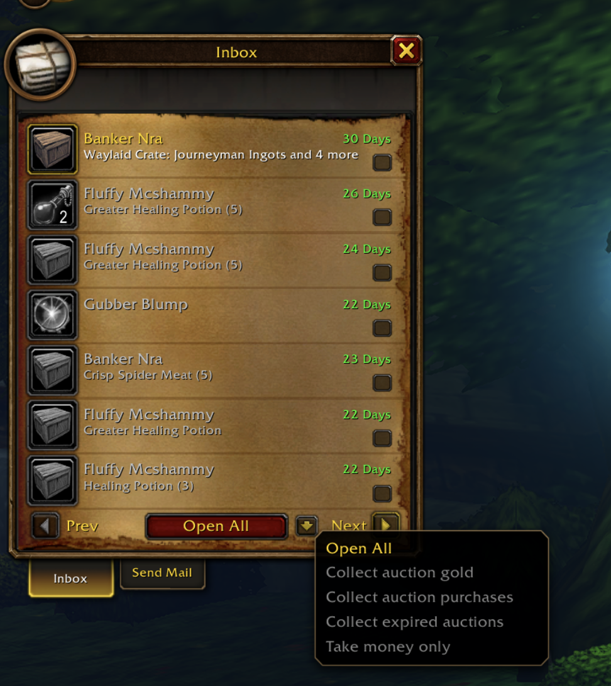

### Trackers & Reminders

#### Unspent Talent Points

A reminder in the middle of the screen while you have **talent points to spend**.

- Hidden while dead, while the talents window is open and, optionally, in combat. Open windows
  cover it.
- Size and position are adjustable.

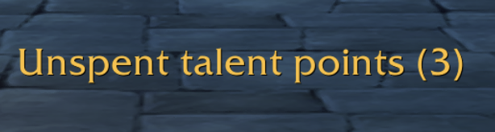

#### Unlearned Abilities

After a respec, abilities you don't know anymore stay on your bars, only greyed out like anything
you can't use right now. This makes them stand out.

- A **red cross** in the corner of their button, and a tooltip line saying it's not learned.
- When your spells change, a message lists the abilities on your bars you lost (after you close the
  talents window). **Click it to take them off**: it asks first, naming them, and waits for combat to
  end if you're fighting.
- It also lists new abilities that aren't on your bars yet.
- `/nra unlearned` lists them, `/nra unlearned remove` takes them off.

#### Reminders & To-Dos

Notes to yourself that come back when they're due. `/nra remind Go to Darkshore and hand in quests`
pops up the next time you log in; `/nra todo respec` just goes on your **to-do list** on screen.

- **Later instead:** put a trigger in front (the same for to-dos).
  - A time: `/nra remind 30m check the auction house` (s, m, h, d: `2d`, `1h30m`).
  - A zone or subzone: `/nra remind in Darkshore: turtle quest` (straight away if you're there).
  - A level: `/nra remind at 30: train`.
  - **Another character's next login:** `/nra remind @Bankalt: mail the bags`. This also goes with the
    others (`@Bankalt at 20: ...`).
- Shift-clicked items and quests work in the text.
- **Reminders** show on a **card that stays until you close it**, led by **why** each came due ("You
  entered Darkshore", "Time's up", "From Bankalt"). One reminder gets **Done** and **Later**; at login the
  card also lists the reminders still open from before, under a line. They wait for combat to end, and
  play a sound (pick it in the settings).
- **To-dos** skip the card and the sound: they go straight on the list when they come due.
- **Zone to-dos** are on the list while you're there. Leave and a little countdown starts (10 s, a
  setting); then they go back to waiting, and come back in their place when you return. The header
  says how many are elsewhere. Right-click one to keep it on the list anyway.
- Arriving in a zone with reminders or to-dos says so in a small message (no sound), shared with
  Quests to Turn In: how many, the zone, then a section for each (**QUESTS**, **REMINDERS & TO-DO**)
  listing them. Click a line to open what it's about.
- **The list on screen** ("Reminders & To-Do") holds both until you tick them (reminders after their
  card, an option), in two parts: **REMINDERS** first, then **TO DO**.
  - A coloured tag says where, when or who from (`Ironforge:`, `21:30:`, `Bankalt:`). Zone tags turn
    **green** while you're there.
  - **In your order:** drag a row, or use the arrows on the row under the mouse (shift-click: to the
    top or bottom).
  - Ticked ones fade out after a moment (untick in time to keep one).
  - Its header: **click** to fold it, **shift-click** to hide it until your next login, **right-click**
    for the Reminders & To-Do tab, **shift-right-click** for the settings. `/nra todo show`, a key (Key
    Bindings > NraKit) or **Show list** in the tab brings it back.
  - Settings for it: size, background opacity (down to just the text; for the header and the items
    together or apart; and a stronger one while the mouse is over it), overall opacity (text too), width and height (with more items than fit, it scrolls), which way it
    grows (down, or up with the header at the bottom), hide the header (it shows while the mouse is
    over the list), tags on or off, lock in place, hide in combat.
- Right-click an item to make a to-do a reminder (or the other way), move it, be reminded again in 15
  minutes, an hour or next login, edit or delete it.
- The **Reminders & To-Do tab** (`/nra remind`) lists them: reminders and to-dos due now, waiting (and
  when they'll come, and whether they pop up), the ones you left your other characters, and done.
  Click one to edit its text; the **gear** on the row (or right-click, **Edit...**) opens it in the form to
  change everything else. **Show list** and **Settings** are at the bottom.
- Write new ones in the tab's box in the same words as `/nra remind`, with the **Reminder | To-do**
  switch next to it, or click **Add** with the box empty for a **form**: reminder or to-do, the text,
  when (next login or now, after a time, a zone you pick from a list or type, a level), and which of
  your characters it's for.
- `/nra preview reminder` shows the card for one reminder, `/nra preview reminders` the one at login.

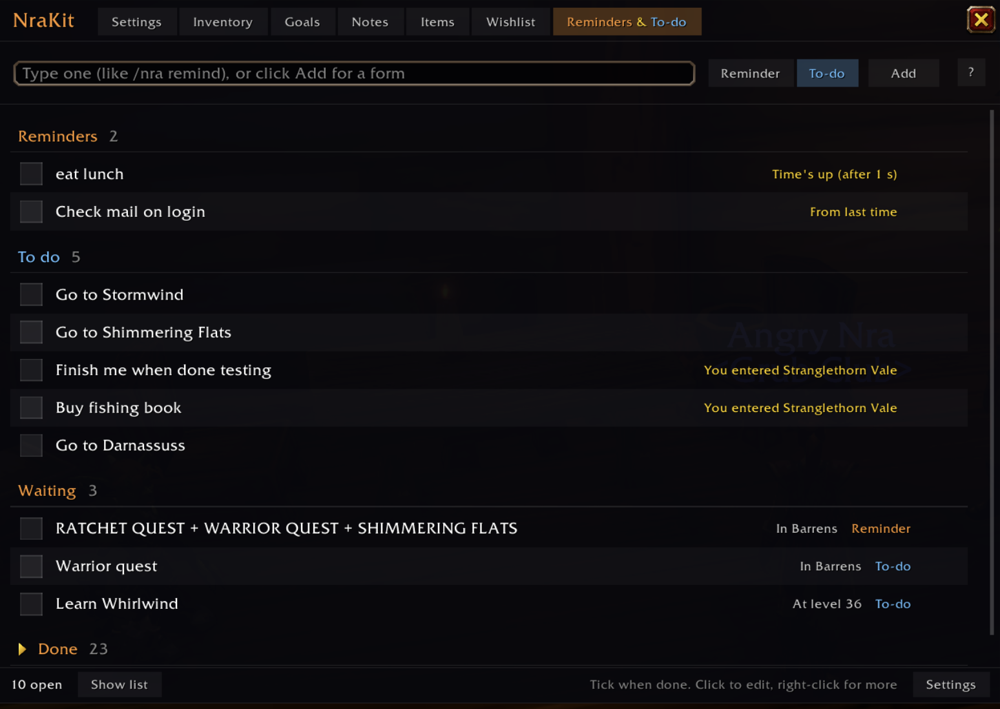
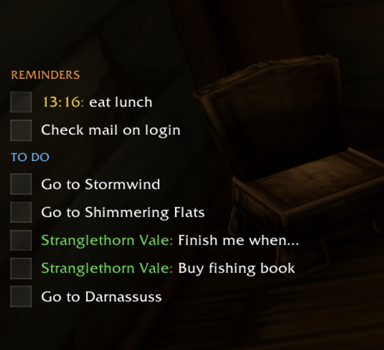
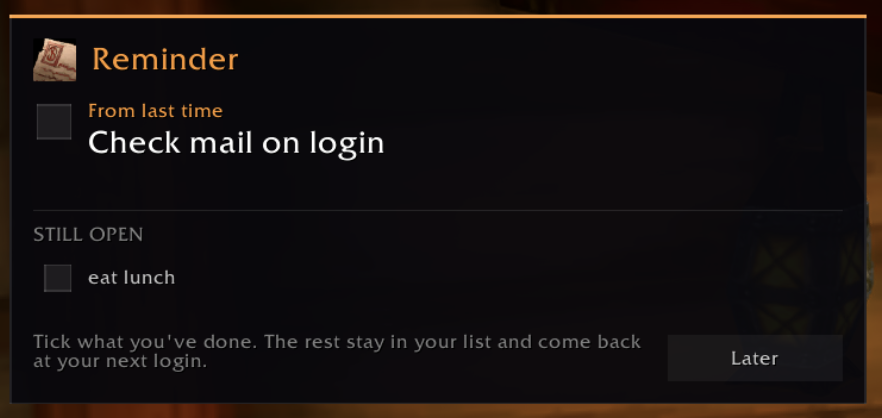
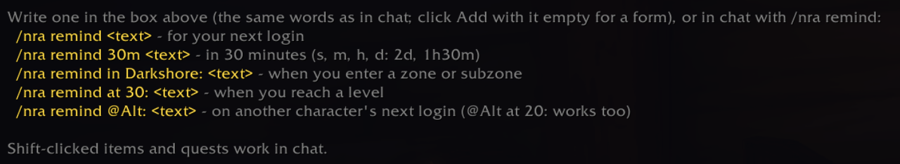

#### Campfire Timer

A progress bar in the middle of the screen while you **rest at a Welcoming Campfire**, with the time
left. It turns green (with a sound) when Camp Benefits is ready.

- **Sleeping bags too:** it counts your Well-Rested stacks up to 3, with the time left once it has
  seen how long a stack takes.
- Width and position are adjustable.
- `/nra campfire` shows a 10-second preview, `/nra preview sleepingbag` the sleeping bag.

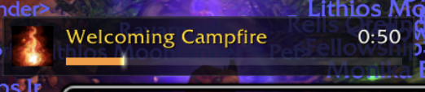

#### Farm Goals

Set goals and track them in a small movable window: progress bar, amount gained, **rate per hour** and
**time left**. Item goals also show what they're **worth** and your **gold per hour** ("18/h · 38g/h"),
at the auction house with Auctionator, else at a vendor.

**Goals you can set:** "loot 4000 Silk Cloth", "reach level 40", "gain 50,000 XP", "earn 100 gold",
"reach Revered with Timbermaw Hold", "Swords to 300 (or to its cap)", or a currency amount (reach a
level or gain an amount).

**Progress and finishing**

- The bars are marked at 25/50/75%, optionally with a chime and a small message there.
- A fanfare and a big message in the middle of the screen when a goal is done (shown again after the
  fight if it happened in combat). The finished goal glows in the tracker until you hover it.
- Click a finished goal to clear it to the history (Restore brings it back), or right-click it to
  **go again** (another run of the same amount) or set a new target.
- Item goals count **what you loot**, so banking, mailing or selling never changes them. They can start
  from what you already have in your bags, bank, mail or on other characters.

**The tracker**

- Three views, picked from the arrow menu in its header (which also locks the tracker):
  - **Full**;
  - **Compact**: one line per goal;
  - **Icons**: a tile per goal with a bar and the amount. The box is just the tiles, growing sideways
    up to 3 per row, with the buttons appearing above it on hover.
- Right-click a goal to pause, edit, **shelve** (hide it from the tracker, paused, until you bring it
  back from the goals window), reset or remove it.
- **Edit** fixes a goal's target, item, starting count or sounds without starting over.
- Each goal can have its own milestone and finish sounds.
- Icons follow what a goal tracks (an axe for Axes, a pick for Mining, coins for gold, the level's
  badge). Or pick your own like a macro icon: click the icon in the goal form and choose one, or drop
  an item or spell on it to use its icon.

**Commands**

- `/nra goal` opens the goals window (new goal, active and shelved goals, history).
- Add goals from chat: `/nra goal 4000 [item]`, `/nra goal level 40`, `/nra goal gold 1g 50s`,
  `/nra goal rep revered timbermaw`, `/nra goal skill swords`, `/nra goal currency 2000 honor`, ...
  (`/nra goal help` lists them all).

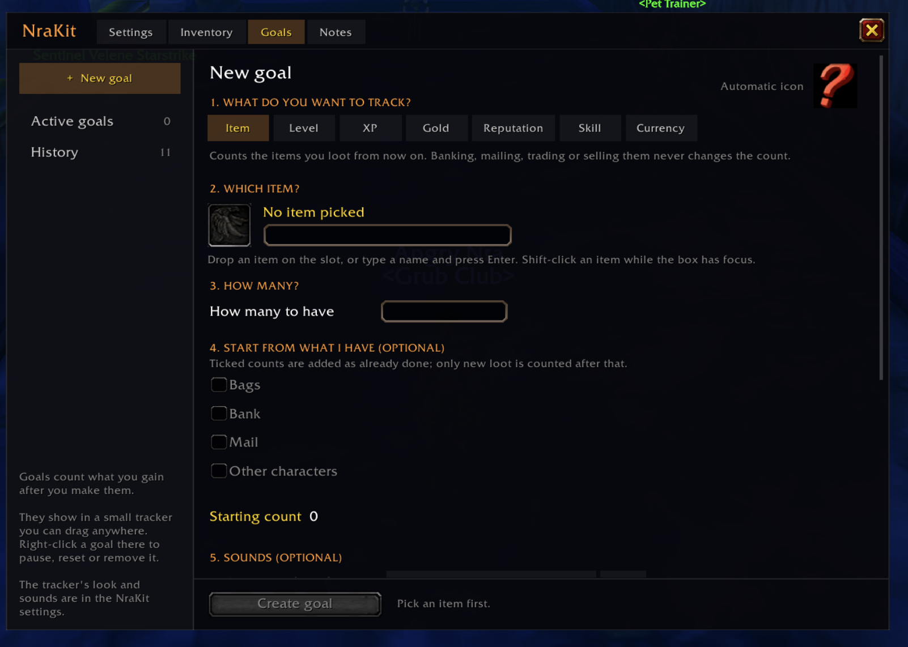
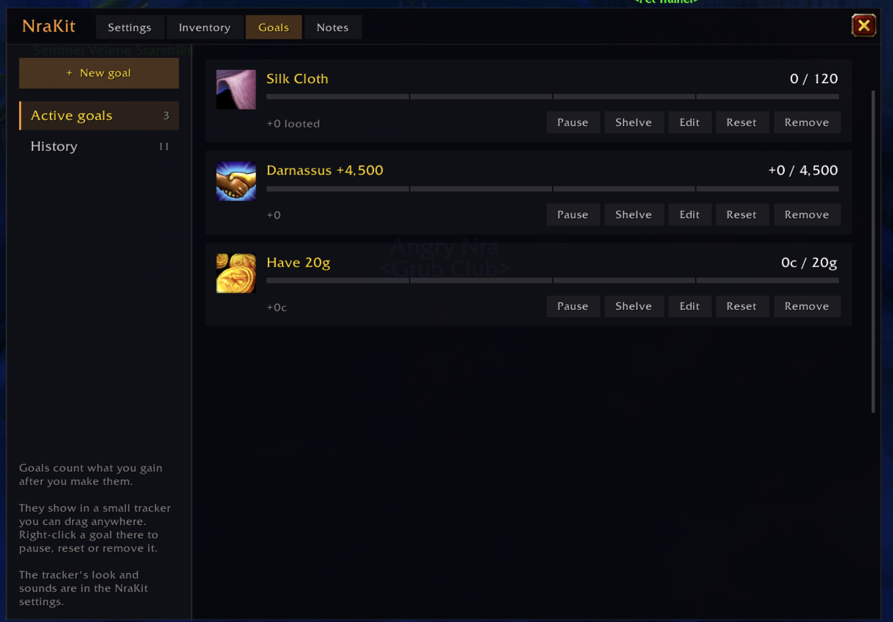
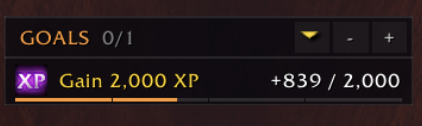
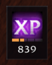
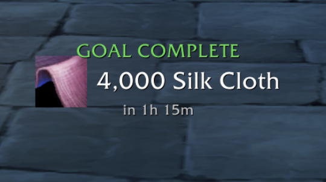

#### Unit Scanner

Alerts you when a **mob or player from your list** shows up.

- **How it alerts:** sound, on-screen text, chat line and taskbar flash.
- **Where it looks:** nameplate range, mouseover, your target, focus or a group member's target,
  minimap markers (rares), and NPCs that yell, say or emote. Optionally raises the nameplate range
  while scanning.
- **Found units** get a raid marker (Moon by default) and a button with the marker and their name:
  click it (or its keybind) to target them, right-click to dismiss, Shift-drag to move.
- **Your list:** target a unit and type `/nra scan` to add or remove it, or use
  `/nra scan <name or NPC ID>`, `/nra scan list`, `/nra scan remove <# or name>` and `/nra scan clear`.
- Addons can only see units the game already shows you, so enemy nameplates should be on. With
  Engaged-Only Nameplates, the scanner keeps them on while the list isn't empty.
- With Player Notes, it also alerts for players labelled Kill on sight (optional, on by default).

### Social

#### Player Notes

Give players a **label** (Kill on sight, Avoid, Neutral or Liked), **tags** of your own and a **dated
log of notes** (each saves the date, zone and your character).

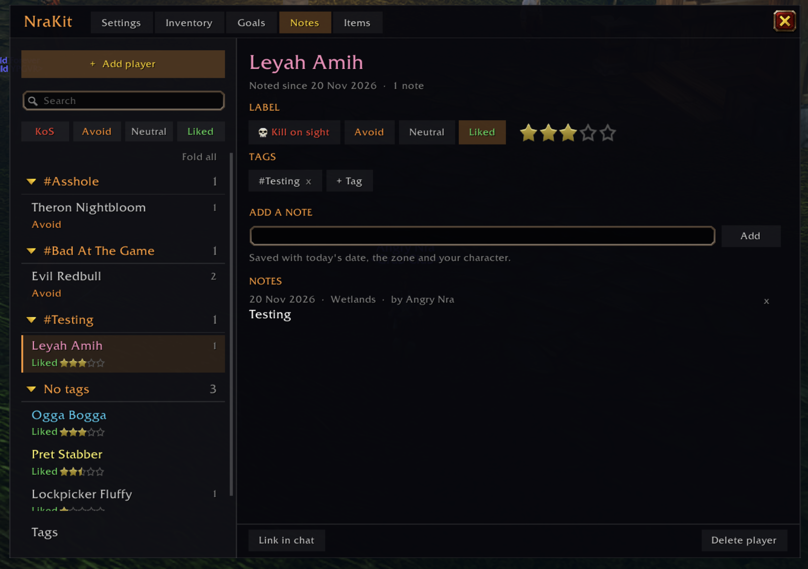

- **Tags** group players your way: Ninjalooter, Good tank, Guildie. A player can have any number.
  - The notebook's list has a section per tag, then the players without tags. Filter chips under the
    search (KoS, Avoid, Neutral, Liked) narrow it to those labels. Click a section to
    fold it, shift-click to fold all the others, or use Fold all.
  - On a player's page, **+ Tag** lists your tags to tick, or makes a new one. From chat, use `#`.
  - The Tags page adds tags, renames them (renaming into an existing tag merges them) and deletes them.
- Their label, tags and latest note show in their tooltip.
- **Right-click a player** (portrait, party frame, chat name, guild and friends lists) → **Player note**
  to label them in one click, or to open their notes.
- **Warnings** (chat, on screen, sound) when a player labelled Avoid or Kill on sight joins your group,
  invites, whispers or trades you.
- **Rate** the players you like, 1 to 5 stars in halves: the stars next to Liked on their page, or
  right-click → Player note → **Like and rate**, which then opens their notes to add a note or tags
  (an option). The stars show in their tooltip and your notes.
- What the label does:
  - Kill on sight: warnings and Unit Scanner alerts;
  - Avoid: warnings;
  - Neutral or Liked: tooltip only.
- `/nra note` opens the notebook, or your target's notes. In the notebook, **+ Add player** adds anyone
  by first name and surname, and you can search by name, label, tag or note text.
- From chat:
  - `/nra note Bob Stone kos #ninjalooter stole my node`;
  - with a player targeted, just `/nra note ninja'd the loot` (or `/nra note avoid ninja'd the loot`
    to label them too);
  - `/nra note !remove` takes your target out of your notes (`!undo` brings them back).
- **Share a note in chat:** shift-click a player in your notebook (or **Link in chat** on their page) to
  put `[NraKit note: Name]` in your chat box.
  - Others with NraKit see it as a link. Clicking it shows the player's label, tags and notes, with
    **Add** and **Cancel**.
  - Added notes keep who wrote them. Notes you already have are skipped, their tags can be left out,
    and your own label (and rating) stays unless you pick theirs.
  - Only players you've linked can be fetched, and only while you're online.

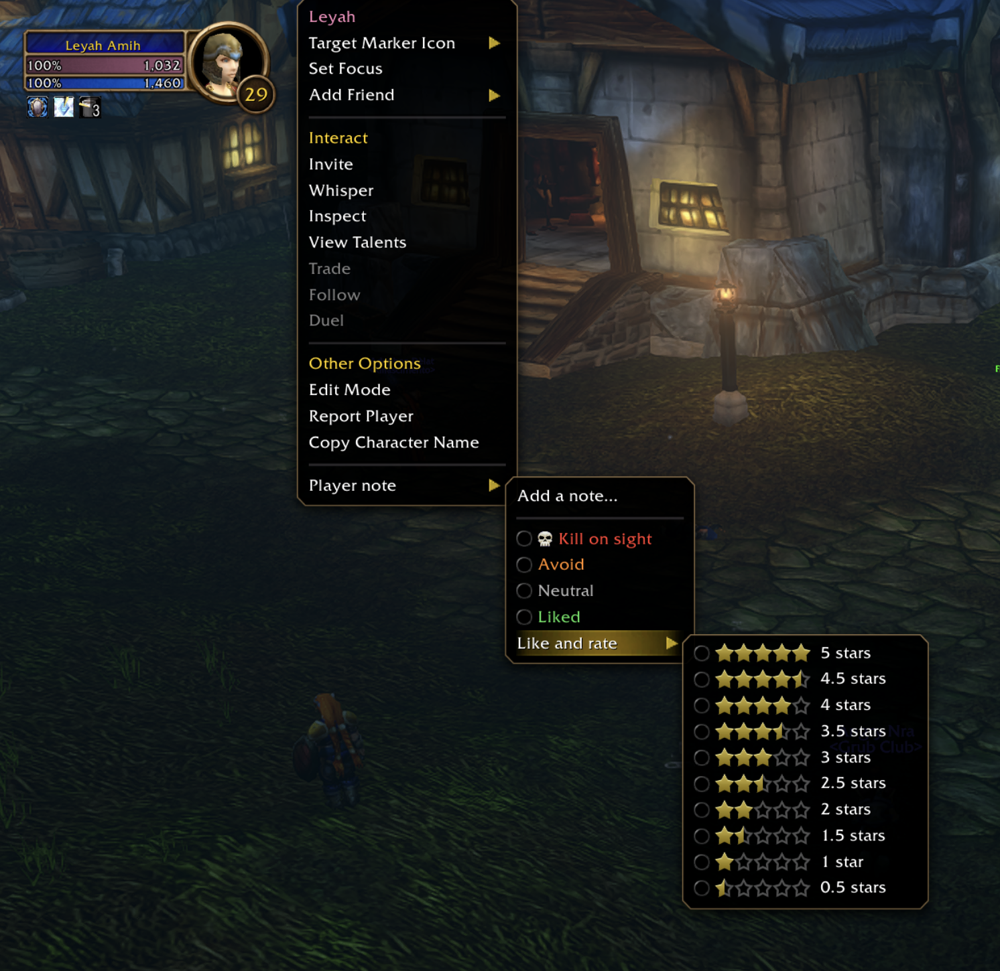

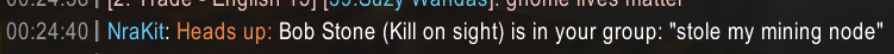

#### Inspect Anything

One key (Key Bindings → NraKit) **inspects your target** (or what's under the mouse when you have
none), in a window like the inspect window (same frame and place). It **stays open until you close
it**, even when they run off or you change target.

- **Players:** their gear around the model (tooltips, Shift-click to link), spec and item level.
  - Inspected in combat, the gear fills in after combat.
  - "Blizzard's inspect" opens the game's window (talents, PvP, guild) while they're near.
  - "Dressing room" tries their outfit on.
- **NPCs:** the 3D model (drag to turn, right-drag to move, wheel to zoom), level, type, health and
  attack speed (the game hides most NPC stats from addons).
  - "Abilities on Wowhead" gives the NPC's Wowhead link.
- Optionally adds "View 3D model" to the right-click menu of NPCs and enemy players.

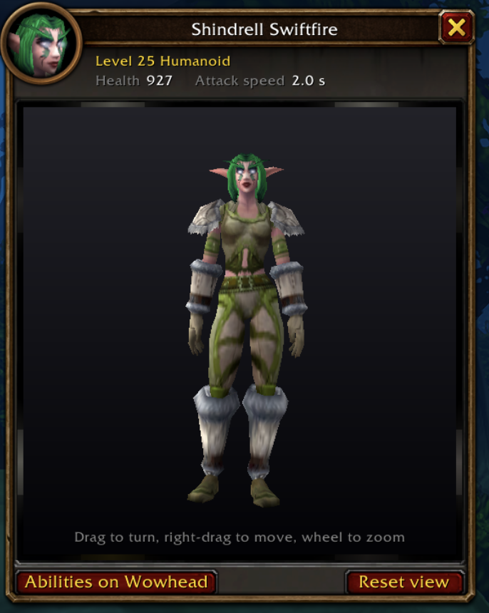

#### Leave Group with /leave

Type `/leave` (with nothing after it) or `/leavegroup` to leave your party, raid or instance group.
`/leave <channel>` still leaves a chat channel.

### Tools

#### Lookup

**Look up every item, spell and profession recipe in the game by name**, in the **Lookup** tab, with
**[ Items ][ Spells ][ Recipes ]** at its top. `/nra item nightbl`, `/nra spell charge` and
`/nra recipe bracers` open it in that mode (`/nra lookup` where you left it).

- **Spells:** every spell, yours first and marked **Known**, with its rank. Hover for its tooltip,
  **Shift+click** to link it in chat.
- **Recipes:** every profession recipe with its profession, what it makes and its reagents. Buttons
  under the search box pick a **profession** (yours first). With
  prices (Auctionator, else vendors): what one craft **costs**, what it **sells for** and the
  **profit**; sort by **Profit** to see what's worth crafting. Hover for the recipe's tooltip with
  what you have and where; right-click for the shopping-list menu. Found once per game version.

**Items:** `/nra item nightbl` lists the matching items (icon, type, required level, how many your
characters have).

- Hover for the tooltip, **Shift+click** to link, **Ctrl+click** to preview, **right-click** to add it
  to your Wishlist (while that's on).
- The game can't search items by name, so the names are learned in the background: a few dozen a
  second, paused in combat, a few minutes once per game version.
- A progress bar in the Items mode has Pause / Resume, and Check again once it's done.
- Undiscovered items are also checked for again daily.

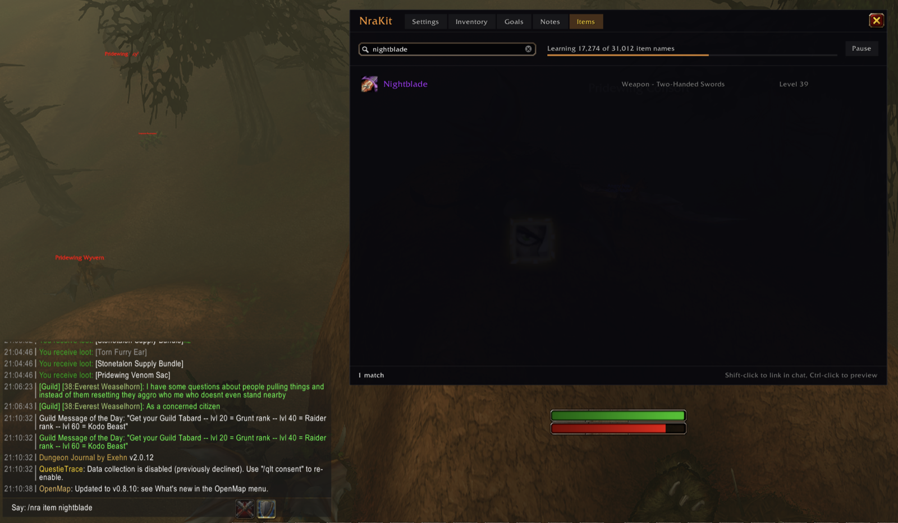
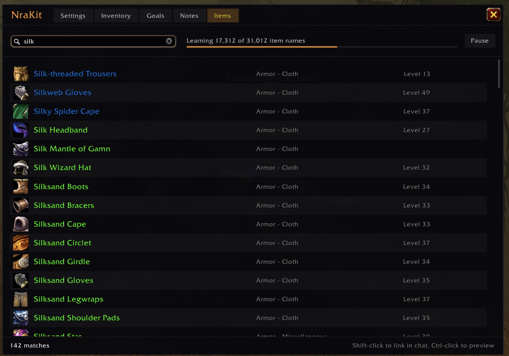

#### Copy Wowhead Link

Hover an item, spell, NPC, quest, achievement or currency and press **Ctrl+C**. A box opens in the
middle of the screen with its wowhead.com/forever link selected; copy it with Ctrl+C (Cmd+C on a Mac)
and the box closes.

- Addons can't reach the clipboard directly, hence the box.
- Works in bags, chat links, the quest log, achievements and the objective tracker.
- Ctrl+C is bound on first use if it's free; change it under Key Bindings → NraKit.

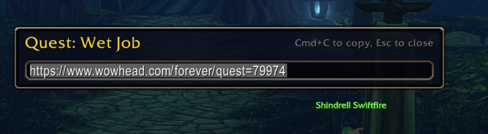

#### Shortcuts

Short commands for NraKit's everyday ones, each the same as its `/nra` command: **`/remind`, `/todo`, `/item`, `/spell`, `/recipe`,
`/dps`, `/shop`, `/bank`, `/goal`, `/note`, `/wish`, `/scan` and `/done`**.

- NraKit **only takes ones nobody else uses**: a command another addon, the game or an emote already has is left
  alone, and an addon that takes one later gets it. `/nra` always works.
- `/nra shortcuts` lists them, and which are in use elsewhere (and by what).
- Each can be turned off, and one whose feature is off isn't taken.

#### NraKit Button

NraKit's icon on screen, wherever you drag it, looking like a minimap button.

- A **badge counts what you may have missed**: reminders you haven't ticked off (not to-dos) and, if
  you want, what's new. The tooltip
  says what.
- **Pick what clicking and shift-clicking it do:** what's waiting (else the NraKit window), the NraKit
  window, a tab, your reminders, quests to turn in, What's New, the menu, or nothing.
- **Right-click** for NraKit's menu, the same as the addon button's (windows, Show due reminders,
  What's New, Settings), with a lock.
- Lock it, size it, or hide it in combat.

## Development

Requires [just](https://github.com/casey/just), [cocogitto](https://github.com/cocogitto/cocogitto) and
Lua (`luac` for the syntax check; LuaJIT for the tests, since it runs Lua 5.1 like the game).
Commits follow [Conventional Commits](https://www.conventionalcommits.org/).

- `just check` syntax-checks the Lua files.
- `just test` runs the tests: the addon is loaded into a stand-in WoW client (`tests/wow.lua`) and its
  windows are clicked through (`tests/*_test.lua`). They also run on every push (GitHub Actions).
- `Changelog.lua` is the player-facing changelog (in game under What's New, and the release notes): add
  a line under `Unreleased` with every change players will notice.
- `just next` shows the next version, the commits going into it and whether the changelog has them.
- `just release` turns `Unreleased` into the next version, writes `CHANGELOG.md`, tags and pushes; CI
  packages it and uploads to CurseForge and GitHub.
- `just release-pre alpha.1` does the same as an alpha/beta pre-release.

## License

[MIT](LICENSE)
