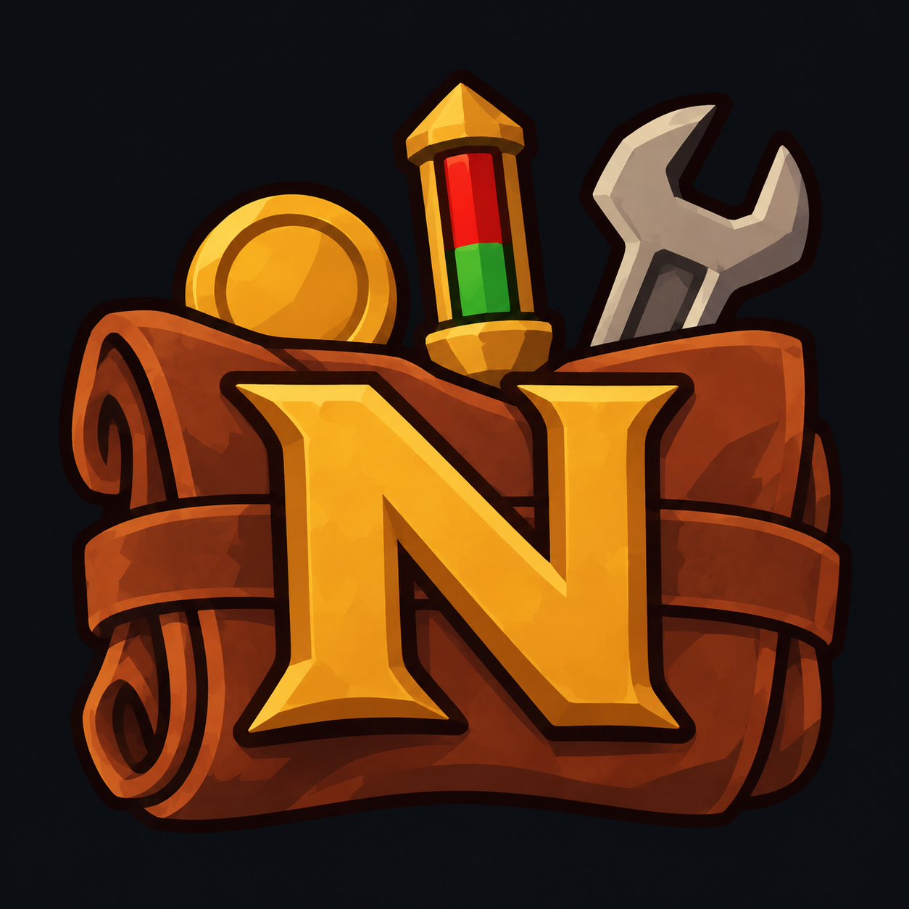

  

# NraKit

A WoW Forever addon with a collection of small quality-of-life tweaks. Every feature is
**off by default**, so turn on only what you want.

## Install
Clone or symlink this repo into `World of Warcraft/_<flavor>_/Interface/AddOns/NraKit`
(the folder name must be `NraKit`).

## Settings
Open the game's Settings panel under **AddOns → NraKit**, or type `/nrakit` (`/nra`).
The main page has an on/off switch for each feature. Features with options get their own
page under NraKit.

## Features
- **Class-colored health bars**: player, target, target of target, focus and party frames
  show class-colored health bars when the unit is a player. NPCs keep the default color.
- **Engaged-only nameplates**: shows full nameplates only for enemies that are actually
  fighting you (optionally your group). Other enemy NPCs are hidden during combat, or
  optionally show just their name, styled like the game's own overhead names. Target, focus
  and enemy players always get full plates. Optionally turns enemy nameplates on when entering
  combat and off when leaving it. Hidden plates can still be clicked where their bar would be,
  because addons can't change a plate's click area during combat.
- **Mark most valuable quest reward**: when a quest offers a choice of rewards, a gold coin
  marks the one that sells to a vendor for the most gold (vendor price × stack size).
- **Bag Tithe**: a button next to the bag sort button (separate or combined bags) highlights
  your least valuable bag slots (vendor price × stack size), ranked from red to yellow, with
  rank numbers and sell values. Everything else is dimmed; the bags work as normal underneath.
  Alt+click an item to leave it out of the ranking; the ignore list is editable in the options.
- **Potential Upgrades**: arrows on bag items and quest rewards, plus a tooltip line, for items
  that beat what you have equipped. Green = clear upgrade (usable now and at least as good on every
  stat that matters for your class, plus armor or weapon DPS). Yellow = likely upgrade (better by a
  simple per-class stat priority). Grey = upgrade once you reach the required level.
- **Open Clams**: a button next to the bag sort button opens the next clam (or any other
  "Right Click to Open" container, except locked boxes) one per click, showing its icon and how
  many are left. Bindable under Keybindings → AddOns → NraKit. Openable items get a green border.

## Development
Requires [just](https://github.com/casey/just), [cocogitto](https://github.com/cocogitto/cocogitto) and `luac`.
Commits follow [Conventional Commits](https://www.conventionalcommits.org/).

- `just check` syntax-checks the Lua files
- `just next` shows the next version and the commits going into it
- `just release` tags the next version and pushes it; CI packages it and uploads to CurseForge and GitHub
- `just release-pre alpha.1` does the same as an alpha/beta pre-release

## License
[MIT](LICENSE)
